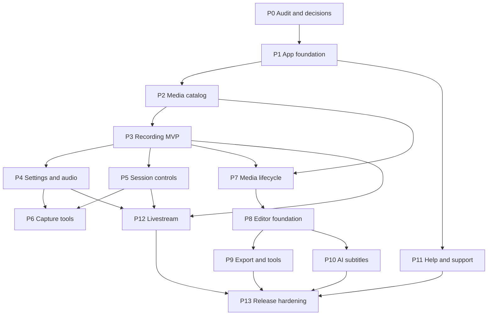

# Android Screen Recorder App — Implementation Phases

This roadmap turns the master plan supplied at `C:\Users\pc\Downloads\XRecorder_Flutter_Implementation_Master_Plan.md`, the repository specifications, and the 89 JPGs in [`requirements/UI_images`](../requirements/UI_images) into a dependency-ordered delivery plan. The set contains 88 unique images (R48/R49 are identical) and four short supplementary MP4s. Screenshot filenames `001`–`089` correspond to `R01`–`R89` in the [reference index](REFERENCE_INDEX.md). The references describe observed UI; they do not prove that the pictured behavior works.

## Scope and working rules

- Target Android first. Keep recording, media, and permission behavior behind Dart interfaces and Android adapters.
- Preserve the existing Flutter conventions unless an audit shows they cannot support a requirement: `go_router`, `ChangeNotifier`, the shared theme/tokens/widgets, and the current feature folders.
- Implement the product independently. Do not reuse the reference app's logo, ad art, premium artwork, or proprietary assets.
- Every visible action must work, explain a platform limitation, or be hidden. Never report a recording, export, upload, share, or live session as successful before the platform confirms it.
- Keep source media intact by default. Save edited/exported media as a new item unless the user explicitly confirms replacement.
- Treat package and native-library names in the research docs as candidates. Pin versions and licenses only after building a small proof of concept against this repository.
- Use the screenshots as composition and interaction evidence; use repository tokens for a single coherent visual system. Resolve the light/dark palette difference before rebuilding screens.

## Repository baseline

The repository is a working UI baseline, not the blank Flutter project assumed by the master plan:

- Flutter 3.47.8 / Dart 3.13.7; package name `xrecorder`; `go_router` is the only runtime Flutter package.
- Existing routes and feature screens cover Video, Photos, Record setup, Edit tools, Settings, media details, and a sample completion page. Media and settings are mock/session-only.
- The shared token/theme/widget layer is present in `lib/core/constants/design_tokens.dart`, `lib/app/theme/app_theme.dart`, and `lib/core/widgets/`. It now includes common fields and overlays. Reuse and refine it rather than introducing a second component library.
- Android has a generated `FlutterActivity`, default Flutter SDK min/target SDK values, and no recording service, MediaProjection declarations, media repository, or runtime permission flow yet.
- `pubspec.yaml` has bundled sample media and Manrope; there is no persistence, media query, editor, or native capture dependency.
- The repository contains a small existing widget test only. There are no recording, device, or export integration tests yet.
- The product specification says the display name is **3HRecorder**, while the repo, README, package, and master plan use **XRecorder**. Treat 3HRecorder as the current product-spec decision and reconcile the code/plan with the product owner before release identity work.
- The product spec suggests a distinct identity and a light/dark neutral palette; the current UI baseline is dark charcoal with coral/cyan accents, while many references use light surfaces and orange accents. Confirm the target palette in Phase 1, then express it through the existing tokens and theme.

## Phase plan

| Phase | Main outcome | Depends on | Reference areas | Exit gate |
|---|---|---|---|---|
| P0 — Repository and product audit | Verified platform constraints, product decisions, dependency shortlist, and risk register | — | All | Audit records actual SDK/Gradle/manifest state, app identity, supported Android range, visual direction, and unresolved backend/monetization choices |
| P1 — App foundation | Stable routing, app shell, persisted settings, localization/theme foundation, and domain contracts | P0 | 003–005, 009, 015–019, 025, 028, 036, 042, 050, 060–061 | Routes preserve tab/list state; settings survive restart; locale/theme choices only appear when resources exist; no duplicate design system |
| P2 — Media catalog | Real Video and Photos libraries, safe folder selection, metadata, thumbnails, search/filter, and storage summary | P1 | 009, 044, 060–062, 083, 085–086 | App-owned and user-selected media load from Android APIs; empty/populated states work; revoked URI and missing-file states are handled |
| P3 — Recording MVP | One real, OS-consented screen recording saved as a playable media item | P0–P2 | 063–065, 088, 011 | Start/cancel/stop works; a multi-minute MP4 plays in another player; output is indexed; denial/failure leaves no fake session or orphan file |
| P4 — Recording configuration and audio | Capability-aware mode, timer, quality, orientation, and audio settings applied to a real session | P3 | 027–036, 042, 077, 088 | Chosen settings are reflected in the native session; microphone/internal/mixed/mute modes report support and failure accurately; timed recording auto-stops at the configured duration |
| P5 — Session controls and recovery | Pause/resume/stop from notification and in-app surfaces; lifecycle recovery; optional floating control | P3 | 006, 011, 021–023, 026, 063, 081, 089 | One native state is reflected after navigation, backgrounding, notification action, Activity recreation, and service termination; overlay denial leaves in-app/notification controls available |
| P6 — Capture tools | Screenshot, region selection, annotation, facecam, and truthful touch guidance | P4–P5 | 004–008, 021, 024–025, 069, 072, 075 | Each tool is permission-gated and device-tested; rendered output matches the chosen capture mode; unsupported global touch observation is explained rather than simulated |
| P7 — Media actions and lifecycle | Preview, share, rename, delete/trash/restore, and complete storage accounting | P2–P3 | 002, 018, 037, 062, 078–079, 083–084 | URI-based sharing works; delete/restore respects Android ownership and confirmation rules; failures preserve original files and metadata |
| P8 — Editor foundation | Non-destructive project model, media picker, playback/timeline, trim/split/merge, crop/rotate, draft save | P2, P7 | 010, 037, 043–044, 046–049, 060, 082 | Draft survives app restart; source files are unchanged; preview and project timeline agree; editor engine is selected from a repository-tested spike |
| P9 — Render, export, and advanced media tools | Export queue plus audio, speed, text, music, filters/background, image edits, compression, GIF, voice effects | P8 | 020, 037, 043–049, 059–060, 082, 084 | Export is playable and matches preview; failure/cancel cleans temporary output but preserves project; gated tools are hidden or truthfully disabled |
| P10 — AI subtitles | Consent-based server transcription, job tracking, subtitle editing, preview, and export | P2, P8; API/backend decision | 002, 010, 037, 043, 046–049, 059–060 | User sees what media leaves the device; job resumes or cancels safely; transcript timestamps can be edited and exported; secrets and sensitive logs are protected |
| P11 — Settings, help, and support | Complete preferences, FAQ/guides, feedback and issue-report flows, app identity polish | P1; can proceed alongside P3–P10 | 003, 012–019, 021–028, 036, 039–040, 050–059, 066–076, 087 | Settings describe real behavior; supported locales are translated (including RTL where offered); reports only claim delivery after confirmed handoff/server response |
| P12 — Livestream | YouTube authorization/broadcast and RTMP/RTMPS setup, publish lifecycle, reconnect and help | P3–P5; provider credentials and policy review | 038–042 | A private/unlisted test stream succeeds on a real eligible account; errors and reconnects are visible; stream keys/tokens are not logged or stored in plain preferences |
| P13 — Release hardening | Device matrix, privacy/security/licensing/accessibility/performance checks, release build and feature gating | All shipped phases | All shipped references | No critical data loss or false-success path; all enabled controls meet acceptance; unsupported or undecided monetization/live/AI features are hidden or explicitly unavailable |

## Phase details

### Implementation progress

- P1 foundation code implemented: stateful four-tab shell, persisted Android preferences, typed domain/service contracts, and English/dark resource boundaries. See [audit](xrecorder/repository_audit.md) and [validation evidence](xrecorder/phase_1_validation.md).
- P2–P6 implementations and remaining device gates are recorded in [P2](xrecorder/phase_2_validation.md), [P3](xrecorder/phase_3_validation.md), [P4](xrecorder/phase_4_validation.md), [P5](xrecorder/phase_5_validation.md) and [P6](xrecorder/phase_6_validation.md). P10/P12 are deferred at the product owner's request under [issue #1](https://github.com/duyhoang17930/XRecorder/issues/1). P7–P9, P11 and P13 remain pending. Emulator evidence is not a physical-device release signoff.

### P0 — Repository and product audit

1. Record existing routes, design tokens, widgets, state handling, tests, assets, and current UI-only behavior. Keep the already-created shared theme/components as the starting point.
2. Inspect Gradle and manifests, generated SDK defaults, Kotlin/Java versions, package/application ID, signing state, and build variants. Produce a permission/API-level matrix before adding capture declarations.
3. Update `docs/xrecorder/repository_audit.md` with current findings, gaps, license candidates, and risks. The existing Vietnamese technology research is a shortlist, not evidence that its candidates build or satisfy the acceptance criteria.
4. Resolve or explicitly defer: product display name/application ID; palette direction; supported Android versions; ad/Pro policy; subtitle backend, retention and cost; YouTube credentials; and initial release scope.

**Gate:** no feature implementation depends on an unverified plugin or unresolved identity/permission assumption. The release name and business model may remain deferred, but related UI must be feature-gated.

### P1 — App foundation

- Preserve four primary destinations (Video, Photos, Edit, Settings) with the center `+` opening the recording-options sheet, as specified by the product docs. Do not add a fifth Tools tab unless product direction changes; the current Edit hub can own tools.
- Add route definitions for media picker/detail, recording settings, help, trash, editor, and live flows as those phases ship. Preserve tab scroll state, handle missing/deleted IDs, and keep fullscreen editor/preview outside the bottom shell where appropriate.
- Define typed domain models and repositories for `MediaItem`, `RecordingSettings`, `RecordingSession`, `EditProject`, `TrashEntry`, and background jobs. Keep platform services behind interfaces.
- Replace the in-memory-only settings implementation with a small persistence adapter and migrations. Add locale/theme settings only for translations and themes that are actually implemented.
- Confirm visual direction and update one shared token/theme system. Reuse the shared cards, fields, dialogs, bottom sheets, search, dropdown and motion components from the previous UI pass.

**Gate:** app builds with the new route skeleton, saved preferences restore, and representative routes render at phone widths and larger text scales.

### P2 — Media catalog

- Implement Android media queries and URI-safe thumbnail loading. Prefer platform/Flutter APIs only after checking their current maintenance, Android-version coverage, and licenses; keep an adapter boundary so a package can be replaced.
- Replace mock Video/Photos content with actual catalog data, grouped/sorted as specified. Add loading, empty, permission-denied, inaccessible URI, and refresh states.
- Implement the folder picker using MediaStore collections and SAF-granted URIs; persist only user-granted access.
- Compute app-owned video/photo/cache/trash totals without double counting. Show device free space separately from app-owned data.

**Gate:** imported and app-created items render without filesystem-path assumptions; picker cancellation and revoked permission return a useful state.

### P3 — Recording MVP

1. Select a narrow native proof of concept: MediaProjection consent, foreground service, one supported encoder, MP4 muxing, stop/finalize, and MediaStore commit. Evaluate the RootEncoder candidate against a minimal native implementation before selecting it.
2. Define a typed Dart/native command and event contract with session IDs, capability results, and typed errors. Keep native state authoritative.
3. Implement one normal screen-capture path, projection accept/cancel, notification status/stop, and a minimal completion route into the real media catalog.
4. Keep mic/internal capture, overlays, pause/resume, and editing out until the baseline file lifecycle is proven.

**Gate:** capture produces a nonzero playable file; projection cancellation creates no output; repeated start/stop commands do not create duplicate sessions; service stop/finalization reports success only after commit.

### P4 — Recording configuration and audio

- Implement normal/performance mode, resolution/FPS/bitrate capability checks, orientation, and audio source selection. Disable unsupported choices with a reason.
- Treat the timer picker as **recording duration/auto-stop**, matching the product spec. Keep a pre-start countdown as a separate option; do not reinterpret the wheel as a future scheduled start.
- Add mute, microphone, internal playback capture where supported, and mixed capture with independent gains. Validate resampling, timestamps, clipping, pause/resume sync, competing mic use, and protected/opted-out playback.
- Persist settings and take an immutable config snapshot for each session so mid-session changes cannot silently alter the active encoder.

**Gate:** recorded metadata and audio match the selected supported configuration within platform tolerances; denial and unsupported modes offer clear fallback.

### P5 — Session controls and recovery

- Add a single state machine spanning idle, preparing, permission, countdown, recording, paused, stopping, finalizing, completed, and failed.
- Add pause/resume/stop notification actions with safe PendingIntents, plus Flutter UI subscription/reconnection after background/foreground and Activity recreation.
- Add optional floating-ball permission onboarding and native overlay controls only after service state and notification actions are reliable. Keep home/settings/in-app controls usable when overlay access is denied.
- Handle projection revocation, low storage, encoder errors, app/service restart, device lock, and duplicate stop requests. Persist a bounded session journal; never persist the projection token.
- Add shake-to-stop only after debounce, sensitivity, and confirmation behavior can be safely validated.

**Gate:** stopping from every enabled surface finalizes the same session once; process/UI lifecycle changes do not fabricate or lose active state.

### P6 — Capture tools

- Ship screenshot capture and a real saved image first; update the photo catalog immediately after commit.
- Implement region selection as normalized coordinates with rotation/inset handling. Use live crop only if the chosen pipeline supports it; otherwise offer a clearly labelled full-screen capture plus crop fallback.
- Implement annotation tools (pen, eraser, shapes, color, undo/redo) and specify whether marks are burned into output or are overlay-only before exposing them.
- Implement facecam only after camera permission, camera-busy handling, preview lifecycle, rotation, and actual compositing into encoded output are proven.
- Touch indicators must follow Android limitations: provide system guidance or app-local visualization, never claim arbitrary cross-app touch capture.

**Gate:** each enabled tool has a permission denial path, cancellation path, saved-output check, and supported-device note.

### P7 — Media actions and lifecycle

- Implement video preview with aspect-fit playback and deterministic player disposal; image preview can use its own route/dialog.
- Add URI-based Android sharing, safe rename, details, trash/restore, and permanent deletion with conflict handling and user confirmation.
- Implement app-managed trash only for app-owned files; use Android-mediated trash requests for shared media where required. Apply the specified 24-hour retention only to entries the app can safely manage.
- Add storage breakdown and refresh based on P2 accounting.

**Gate:** share uses `content://` URIs and temporary grants; delete/restore tests cover duplicates, revoked access, and interrupted operations without data loss.

### P8 — Editor foundation

- Run an editor-engine spike before locking dependencies. Compare `pro_image_editor`/`pro_video_editor` and Android Media3 for the required operations, build size, codec behavior, maintenance, and licenses.
- Add a non-destructive project model, draft persistence, undo/redo, media selection, playhead/timeline, trim handles, split, reorder, delete, merge, crop, and rotate.
- Make preview playback the timeline clock. Generate/cache thumbnails asynchronously and preserve project state across app restart.
- Do not present an editor button as successful when it only routes to sample content.

**Gate:** a project can be reopened, previewed, and edited without modifying its original media; timeline ranges remain valid after split/reorder/delete.

### P9 — Render, export, and advanced tools

- Add a persistent export job with progress, cancel, retry, temporary-file cleanup, and MediaStore commit only after success.
- Implement core transformations in dependency order: trim/split/merge output, crop/rotate, resolution/FPS selection, then speed/volume/audio tracks, text, music, filters, background, and image editing.
- Add compression and GIF as derived exports with size/duration limits and estimates. Add voice effects only after DSP is proven on microphone/editor audio and does not corrupt unrelated internal audio.
- Watermark or premium toggles must remain absent until product policy and entitlement behavior are decided.

**Gate:** exported files play in another player, match preview dimensions/duration/audio within documented tolerances, and failed exports leave the draft intact.

### P10 — AI subtitles

- Confirm backend provider, supported languages, upload limits, data retention/deletion, cost controls, authentication, and privacy notice before implementing upload.
- Define a job API and state model (queued/uploading/processing/complete/failed/cancelled); extract/upload only the necessary audio where the provider allows it.
- Add subtitle language selection, editable text/timestamps, preview synchronization, and export/render integration. Persist job IDs and recover progress after app restart.
- Use the existing research's faster-whisper/FastAPI proposal only as a candidate requiring a deployable backend, load/security review, and quality checks for Vietnamese and English.

**Gate:** users can inspect and delete submitted media/job data according to the final policy; subtitles survive retries and align with the media timeline.

### P11 — Settings, help, and support

- Complete recording, audio, floating controls, repair/stability, storage, trash, account, and shortcut settings by wiring each value to the real service/repository.
- Implement searchable FAQ categories and guides as structured/localization-ready content; recreate diagrams with original/licensed assets.
- Implement feedback and issue reporting with attachment selection, MIME/size validation, explicit diagnostics consent, redaction, progress, cancellation, and truthful completion states.
- Add supported translations, including RTL layout for Arabic if Arabic is shipped. Do not show languages that lack translated resources.

**Gate:** every settings/help/support action either performs its operation or states its limitation; translations pass layout and accessibility checks.

### P12 — Livestream

- Prototype YouTube and RTMP only after P3–P5 provide stable capture, audio, and lifecycle behavior. Verify current provider APIs, OAuth requirements, quota, terms, and test-account eligibility at implementation time.
- Keep OAuth and stream keys in secure storage; use PKCE/system browser for account authorization; never ask for account passwords.
- Add preflight, create/bind/start/stop/finalize states, reconnect/backoff, visible network errors, and local-recording fallback only with explicit user choice.
- If provider credentials or eligibility are unavailable, keep these features hidden or show an actionable unavailable state.

**Gate:** complete a private/unlisted real broadcast and forced network-loss recovery without leaked credentials or stale live status.

### P13 — Release hardening

- Run unit, widget, Android integration, accessibility, and device tests for each shipped feature. Cover permission accept/deny, projection stop, Activity/service lifecycle, rotation, low disk, encoder failure, large text, RTL, storage URI revocation, export cancellation, and network loss.
- Test representative devices across the declared Android support range; include physical hardware for MediaProjection, camera/mic, notification/overlay, thermal load, and long recording.
- Verify privacy disclosures, least-privilege manifest, secure credential storage, dependency licenses, native ABI/page-size constraints, release signing, crash handling, and app-store requirements.
- Gate uncertain monetization and premium features behind actual policy/entitlement decisions. Remove unused sample-only controls from release builds.

**Release gate:** all enabled visible controls have real success/cancel/failure behavior, generated media is discoverable and playable, no critical data-loss/security defect remains, and limitations are documented.

## Dependency view

P11 content work, editor-engine research, and backend/provider research can proceed in parallel after P1, but their production integrations remain gated by the dependencies above.

## First implementation sequence

1. Finish P0 and write the repository audit; settle the app name and palette direction before branding changes.
2. Complete P1 route/data/settings foundations, reusing the shared component system already in `lib/core/widgets/`.
3. Implement P2 media indexing and populate/empty library states before native recording so saved output has a working destination.
4. Prototype and implement P3 as a narrow end-to-end recording slice before expanding audio, overlays, editor, or live features.
5. After each phase, update the [reference index](REFERENCE_INDEX.md) with route, implementation status, test evidence, and any screenshot-derived assumption.

## Product decisions that remain gates

| Decision | Current conflict or unknown | Blocks |
|---|---|---|
| Product identity | `APP_SPEC_VI.md` says 3HRecorder; app/repo/master plan say XRecorder | Release label, icon, IDs, copy |
| Visual direction | Current baseline is dark coral/cyan; product spec suggests neutral light/dark; many images are light | Rebuilding all screen compositions |
| Supported Android range | Gradle currently uses Flutter defaults; no capability matrix exists | Manifest, MediaProjection, foreground-service declarations |
| Monetization | Ad/PRO policy and entitlements are undecided | Ads, premium locks, purchases, watermark options |
| AI subtitles | Server-side processing is selected, provider/backend/retention/cost are not | Upload and transcription implementation |
| Live services | YouTube credentials, quota, account eligibility, and RTMP product requirements are not set | Real broadcast flow |

