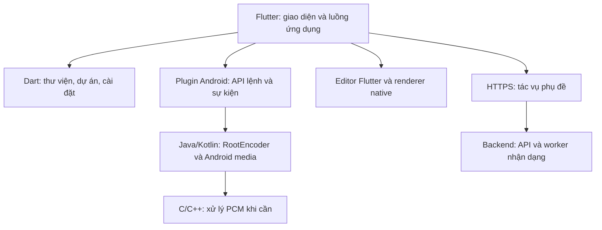

# 3HRecorder — Khảo sát thư viện, repo và kiến trúc tích hợp

Ngày khảo sát: **04/11/2026**. Nền tảng đầu tiên: **Android**. Ứng dụng: **Flutter/Dart**. Phạm vi: toàn bộ chức năng trong [đặc tả](APP_SPEC_VI.md), đối chiếu [89 ảnh tham chiếu](REFERENCE_INDEX.md).

## 1. Kết luận lựa chọn

**Cập nhật quyết định07/11/2026:** AI đã chuyển sang whisper.cpp offline theo yêu
cầu chủ sản phẩm. Các dòng faster-whisper/server và “offline trong tương lai”
bên dưới là nghiên cứu lịch sử04/11, không phải kiến trúc hiện tại. Runtime dùng
Media3 1.11.1, whisper.cpp1.9.5 CPU/JNI (local CPU abort patch), RNNoise0.1;
xem [reuse/provenance](implementation/REUSE_REGISTER.md) và
[AI evaluation](implementation/P2_P3_AI_SUBTITLE_EVALUATION.md) cho bằng chứng thực thi.

Có thể tham khảo và tái sử dụng dự án ở nhiều ngôn ngữ để xây 3HRecorder bằng Flutter. Phương án ưu tiên là giữ các lõi media tốt ở ngôn ngữ gốc, kết nối chúng với Flutter; chỉ chuyển sang Dart các phần phù hợp như giao diện, cấu hình, mô hình dự án và quy tắc nghiệp vụ.

**Bộ ứng viên ưu tiên thử nghiệm:**

| Phần | Ứng viên chính | Cách dùng trong 3HRecorder |
| --- | --- | --- |
| Giao diện và luồng | Flutter/Dart | Thiết kế nhận diện riêng, thư viện, editor, cài đặt, màn live và phụ đề |
| Quay, mã hóa, trộn âm thanh, RTMP | [RootEncoder — Java/Kotlin](https://github.com/pedroSG94/RootEncoder) | Plugin Android riêng; Flutter gửi lệnh và nhận trạng thái |
| Editor ảnh | [pro_image_editor](https://github.com/hm21/pro_image_editor) | Tái sử dụng các công cụ, tùy biến giao diện |
| Xử lý/xuất video | [pro_video_editor](https://github.com/hm21/pro_video_editor) | Thử cùng editor ảnh và video player; kiểm tra từng khả năng xuất |
| API chỉnh video dự phòng | [AndroidX Media3](https://developer.android.com/media/media3/transformer) | Bổ sung qua plugin nếu renderer đã chọn thiếu chức năng |
| Đổi cao độ/nhịp giọng | [Sonic — C](https://github.com/waywardgeek/sonic) | Thử trong pipeline PCM native, trước bước trộn âm thanh |
| Giảm ồn giọng nói | [RNNoise — C](https://github.com/xiph/rnnoise) | Ứng viên nâng cao; so sánh với giảm ồn hệ thống |
| Phụ đề AI máy chủ | [faster-whisper — Python/CTranslate2](https://github.com/SYSTRAN/faster-whisper) | Worker nhận dạng giọng nói, trả chữ và mốc thời gian qua API |
| Thư viện và dữ liệu dự án | [photo_manager](https://pub.dev/packages/photo_manager), [drift](https://pub.dev/packages/drift) | Media hệ thống và metadata/bản nháp riêng |

Đây là **shortlist để tích hợp và kiểm chứng**, chưa phải bộ dependency đã build thành công. Không có một repo được xác nhận bao phủ nguyên bộ hành vi XRecorder chỉ bằng cách đổi tên app.

## 2. Đã kiểm tra đến đâu

- Đã tra cứu trang chính thức, README, giấy phép công bố, API/example và một số mã nguồn liên quan trực tiếp. Ví dụ: `MixAudioSource.kt` của RootEncoder, ví dụ editor và API nhận dạng có timestamps.
- Chưa clone/build toàn bộ các repo; chưa có bài đo FPS, độ trễ, chất lượng âm thanh hay APK chạy trên máy thật.
- Phiên bản hiển thị trên pub.dev và các trang được lập chỉ mục có thể khác nhau. Vì chưa giải dependency/build, tài liệu **không giả định các số phiên bản nhìn thấy đã tương thích với nhau**.
- Metadata SDK trên máy ghi Flutter **3.47.8**, Dart **3.13.7**. Đây là thông tin đọc từ `flutter.version.json`, không phải kết quả xác nhận cả toolchain hoạt động.

Mỗi thành phần cần được chốt **tag/commit hoặc phiên bản package cụ thể** sau khi thử nghiệm; lưu lockfile và thông báo giấy phép theo bản thật sự dùng.

## 3. Dùng mã khác ngôn ngữ trong Flutter như thế nào

| Nguồn | Hướng ưu tiên | Khi nên viết lại |
| --- | --- | --- |
| Java/Kotlin Android | Plugin Android với API Dart; dùng Pigeon/platform channels hoặc JNIgen khi phù hợp | Quy tắc nghiệp vụ thuần túy cần dùng chung |
| C/C++ có thể build Android | Giữ thư viện, thêm C ABI và FFI; hoặc JNI nếu xử lý nằm trong pipeline Android | Thuật toán nhỏ, ít yêu cầu hiệu năng và dễ kiểm chứng tương đương |
| C#/.NET | Chạy thành backend nếu thư viện phù hợp máy chủ; dùng repo desktop làm tài liệu thiết kế | Phần logic độc lập hệ điều hành; không chuyển nguyên API Windows sang Android |
| Python | Giữ worker AI/backend, ứng dụng gọi HTTPS | Không cần chuyển mô hình nhận dạng sang Dart khi đã chốt xử lý máy chủ |
| Repo web/JavaScript | Tham khảo timeline, mô hình chỉnh sửa, UX và định dạng dự án | Viết UI bằng Flutter; kiểm tra lại renderer và API Android |

Flutter có tài liệu chính thức cho [native interop](https://docs.flutter.dev/interop), [platform channels](https://docs.flutter.dev/platform-integration/platform-channels) và [FFI](https://docs.flutter.dev/interop/bind-native-code). Chọn cơ chế binding theo loại thư viện, không nhất thiết cùng một cơ chế cho cả app.

**Ranh giới hiệu năng đề xuất:** Dart truyền lệnh, cấu hình, đường dẫn/URI, metadata, trạng thái và tiến độ. Khung hình và PCM chạy trong pipeline native; tránh chuyển liên tục video độ phân giải cao qua thông điệp Dart. Giao diện Flutter không cần trực tiếp thực hiện việc mã hóa từng khung hình.

## 4. Repo/thư viện chính và giới hạn

### 4.1. Quay và livestream

**RootEncoder — Java/Kotlin, Apache-2.0.** Ưu tiên vì có capture màn hình, mã hóa và RTMP/RTMPS trong cùng hệ thư viện. Không cần quyền root chỉ vì tên repo có chữ Root. [README và giấy phép](https://github.com/pedroSG94/RootEncoder).

Đã thấy mã nguồn [MixAudioSource](https://github.com/pedroSG94/RootEncoder/blob/master/encoder/src/main/java/com/pedro/encoder/input/sources/audio/MixAudioSource.kt) cho micro và âm thanh nội bộ, có mức âm lượng riêng. [Wiki kiến trúc](https://github.com/pedroSG94/RootEncoder/wiki) mô tả nguồn screen/camera/file và hướng dùng StreamBase.

**Phần phải tự tích hợp:** cấp quyền, service, bộ điều khiển phiên, bóng nổi, thông báo, cấu hình codec, lưu tệp, xử lý khi Activity biến mất và đồng bộ trạng thái với Flutter. Khả năng có trong thư viện không đồng nghĩa luồng ứng dụng đã được hoàn thành.

Đặc biệt, có `setAudioEffect` trong nguồn trộn **chưa chứng minh hiệu ứng chỉ áp dụng lên micro**. Nếu muốn giọng game giữ nguyên và chỉ đổi giọng người nói, phải xác minh/chỉnh pipeline để DSP chạy trước bước trộn. Có [báo cáo lệch A/V khi đổi nguồn âm thanh](https://github.com/pedroSG94/RootEncoder/issues/2036); đây là trường hợp cần thử, không phải kết luận mọi phiên bản đều bị lỗi.

**HBRecorder — Java, MIT:** [repo](https://github.com/HBiSoft/HBRecorder). Là phương án quay đơn giản để so sánh. Không chọn làm lõi chính trước khi xác minh hỗ trợ âm thanh nội bộ/trộn tiếng và phạm vi livestream.

**flutter_screen_recording — Flutter/native, MIT:** [package](https://pub.dev/packages/flutter_screen_recording). API công bố có quay màn hình và micro; chưa đủ bằng chứng cho bộ yêu cầu âm thanh nội bộ, mix, vùng, Facecam và RTMP. Có thể làm mẫu plugin, không đánh dấu là giải pháp toàn bộ.

### 4.2. Editor ảnh và video

**pro_image_editor + pro_video_editor — Dart và mã nền tảng, BSD-3-Clause.** [Editor ảnh](https://github.com/hm21/pro_image_editor), [renderer video](https://github.com/hm21/pro_video_editor), [ví dụ tích hợp chính chủ](https://github.com/hm21/pro_video_editor/blob/stable/example/lib/features/editor/pages/video_editor_basic_example_page.dart).

Ưu tiên thử nghiệm cặp này cho công cụ chỉnh ảnh, lớp chữ/hình vẽ, thao tác clip và xuất. UI và renderer là những phần cần nối với nhau; vẫn cần mô hình dự án, lưu bản nháp và kiểm tra kết quả xuất của 3HRecorder.

Danh sách tính năng hiện công bố khá rộng, nhưng cần kiểm tra bằng chính phiên bản được khóa. Không lấy một thảo luận cũ về FFmpeg năm 2025 để kết luận chắc chắn cấu trúc mọi bản mới. Khi tích hợp phải đọc dependency native và pipeline của bản đã chọn.

**Media3 Transformer — Java/Kotlin:** [tài liệu Android chính thức](https://developer.android.com/media/media3/transformer). Là hướng bổ sung native cho tác vụ editor, không phải bộ giao diện timeline hoàn chỉnh.

**native_video_editor:** [package](https://pub.dev/packages/native_video_editor). Đáng dùng để đối chiếu API Media3/AVFoundation; bản mô tả hiện tại ghi text overlay và filter nâng cao còn nằm trong kế hoạch, nên chưa thay thế toàn bộ editor đã chọn. Giấy phép của đúng phiên bản cần kiểm tra trước khi đưa vào dependency chính.

### 4.3. Xử lý âm thanh bằng C/C++

- **Sonic — C, Apache-2.0:** [repo](https://github.com/waywardgeek/sonic), [tài liệu](https://github.com/waywardgeek/sonic/blob/master/doc/index.md). Ứng viên đổi pitch/tempo. Các preset trẻ em, ông già, robot… vẫn cần thiết kế và nghe thử; đổi pitch không tự tạo ra tất cả chất giọng.
- **RNNoise — C, BSD-3-Clause:** [repo](https://github.com/xiph/rnnoise). Ứng viên giảm ồn giọng nói. Phải nối đúng sample rate, kích thước khung và xử lý resampling theo API/model chọn dùng; không mặc định dùng cùng cấu hình cho mọi phiên bản.
- **Android NoiseSuppressor:** ưu tiên so sánh chất lượng/độ trễ với giải pháp hệ thống trước khi đưa thêm model vào APK. Việc có hiệu ứng hệ thống tùy thiết bị.

Chỉ áp dụng DSP phù hợp lên kênh giọng nói; cần nghe so sánh với âm nhạc/game. Khi đổi giọng, buffer đầu ra và timestamp phải giữ A/V đúng nhịp. Đây là hạng mục thử nghiệm native, không chỉ là màn chọn preset.

### 4.4. FFmpeg và các wrapper

**FFmpegKit cũ đã nghỉ; FFmpegKitNext là hướng tiếp nối đang công bố.** [Thông báo của repo cũ](https://github.com/arthenica/ffmpeg-kit), [repo FFmpegKitNext](https://github.com/arthenica/ffmpeg-kit-next).

Repo tiếp nối ghi phân phối dạng **source-only**. Vì vậy phải kiểm chứng build, ABI, cấu hình thư viện và binding Flutter; không coi đây là một bộ binary có thể tải từ dependency cũ. Giấy phép công bố của wrapper là LGPL-3.0, có cấu hình GPL khi bật thư viện tương ứng; kiểm tra đúng build được dùng.

Đề xuất giữ làm lựa chọn cho định dạng/hiệu ứng mà pipeline native chính chưa xử lý tốt. Không đưa FFmpeg và nhiều renderer khác vào APK ngay từ đầu nếu cùng làm một việc. Với C/C++, kiểm tra [hỗ trợ trang nhớ 16 KB theo Android](https://developer.android.com/guide/practices/page-sizes).

### 4.5. Phụ đề AI và .NET

**faster-whisper — Python/CTranslate2, MIT:** [repo](https://github.com/SYSTRAN/faster-whisper), [mã xử lý timestamps/VAD](https://github.com/SYSTRAN/faster-whisper/blob/master/faster_whisper/transcribe.py). Đề xuất worker máy chủ; thử model đa ngôn ngữ với mẫu tiếng Việt/Anh và âm thanh game thực tế. Không dùng model chỉ tiếng Anh cho yêu cầu tiếng Việt.

**FastAPI — Python, MIT:** [repo và cấu hình dự án](https://github.com/fastapi/fastapi/blob/master/pyproject.toml). Ứng viên API tác vụ; hệ thống hàng đợi, lưu tạm, hạn mức và xóa dữ liệu phải được xây thêm. Không chạy nhận dạng dài ngay trong vòng đời một HTTP request rồi coi như đã có hệ thống tác vụ.

**whisper.cpp — C/C++, MIT:** [repo](https://github.com/ggml-org/whisper.cpp). Phương án đối chiếu cho worker native hoặc offline trong tương lai; không thay đổi quyết định hiện tại là AI qua máy chủ.

**FFMpegCore — C#/.NET, MIT cho wrapper:** [repo](https://github.com/rosenbjerg/FFMpegCore). Hữu ích nếu dùng backend .NET để phân tích/chuyển mã; vẫn cần binary FFmpeg với cấu hình và giấy phép riêng. Không cần port wrapper này sang Dart nếu nó chạy phía server.

**ScreenRecorderLib — C#/C++, MIT:** [repo](https://github.com/sskodje/ScreenRecorderLib). Chỉ dùng tham khảo kiến trúc/trạng thái capture desktop: repo dựa trên Windows Media Foundation, không phải lõi capture Android. Viết lại cú pháp C# thành Dart không tạo ra API MediaProjection tương đương.

## 5. Bảng phủ toàn bộ chức năng

Các hàng dưới đây là **phương án triển khai**, không phải danh sách chức năng đã chạy. “Có nền” nghĩa là đã tìm được API/thư viện liên quan; vẫn phải tích hợp và nghiệm thu.

### Quay và công cụ trong lúc quay

| ID | Chức năng | Nền tái sử dụng | Phần 3HRecorder cần làm |
| --- | --- | --- | --- |
| F01 | Quay toàn màn hình | RootEncoder + MediaProjection | Plugin, cấp quyền và vòng đời phiên |
| F02 | Chỉ quay một ứng dụng | MediaProjection Android | Luồng chọn của hệ thống, resize và kiểm tra lớp phủ |
| F03 | Quay một khu vực | Capture + crop/filter native | UI chọn vùng, quy đổi tọa độ, áp dụng trước xuất |
| F04 | Micro, nội bộ, cả hai, tắt tiếng | Nguồn âm thanh RootEncoder | Chọn nguồn, xin quyền, báo nguồn không khả dụng |
| F05 | Âm lượng riêng, mono/stereo | Cấu hình audio/native | Nối điều khiển và xác minh output |
| F06 | Pause/resume | Record controller native | Timestamp và đồng bộ các điểm điều khiển; thử theo phiên bản |
| F07 | Hẹn thời lượng tự dừng | Bộ điều khiển phiên | Đồng hồ đơn điệu phía service; không phụ thuộc Dart Timer khi app ẩn |
| F08 | Đếm ngược trước quay | Flutter và điều khiển phiên | Hủy, xác nhận quyền, đồng bộ thời điểm bắt đầu |
| F09 | Hướng tự động/ngang/dọc | Android display + pipeline | Resize/rotate, tỷ lệ và metadata |
| F10 | Độ phân giải, bitrate, FPS, 2K/4K | Encoder native | Khả năng phần cứng và cấu hình hỗ trợ; FPS cao có điều kiện |
| F11 | Chế độ thường/hiệu suất | Cấu hình pipeline | Định nghĩa preset có đo lường; không chỉ đổi nhãn |
| F12 | Bóng nổi kéo/thả | WindowManager hoặc flutter_overlay_window | Menu, vị trí, kích thước, độ mờ và trạng thái |
| F13 | Gán nút, thu nhỏ, ẩn bóng/kết quả | UI và cấu hình riêng | Quy tắc hiển thị trước/trong/sau quay |
| F14 | Thông báo pause/stop/công cụ | Foreground service Android | Actions tới cùng một controller với app và overlay |
| F15 | Bút, tẩy, hình, mũi tên, undo | Flutter Canvas hoặc native Canvas | Lớp phủ ngoài app, thao tác cảm ứng, đưa vào bản ghi |
| F16 | Chụp màn hình | Capture surface/ImageReader/filter | Chụp khung, lưu ảnh, xem nhanh; dùng chung phiên khi phù hợp |
| F17 | Facecam kéo/thay cỡ/đổi camera | CameraX/Camera2, nguồn/filter camera | Ghép vào bản ghi, service/camera lifecycle; không chỉ preview trong app |
| F18 | Hiệu ứng Facecam | Shader/filter/camera pipeline | Preset ánh sáng, tương phản; kiểm tra đồng thời camera và screen |
| F19 | Đổi giọng và nghe mẫu | Sonic + DSP bổ sung | Preset, preview, hiệu ứng trước mix và bù trễ |
| F20 | Giảm ồn khi quay | NoiseSuppressor hoặc RNNoise | So sánh, bật/tắt, định dạng PCM |
| F21 | Giảm tiếng game khi nói | Mức âm lượng + đo mức micro | Ducking realtime riêng; không coi ducking offline là đã có realtime |
| F22 | Lắc để dừng | SensorManager/sensors_plus | Ngưỡng, độ nhạy, chống kích hoạt lặp ở service |
| F23 | Hiển thị cảm ứng | Hướng dẫn tùy chọn hệ thống | Điều hướng trợ giúp; không hứa app tự bật được tùy chọn hệ thống |

### Thư viện, editor và xuất

| ID | Chức năng | Nền tái sử dụng | Phần 3HRecorder cần làm |
| --- | --- | --- | --- |
| F24 | Thư viện video/ảnh, thumbnail | photo_manager + video metadata | Nhóm ngày, trạng thái trống, phân trang và quyền truy cập |
| F25 | Xem ảnh/phát video/tua | Flutter Image + video_player | Màn xem, điều khiển và các điểm vào editor |
| F26 | Đổi tên, chia sẻ, xóa | MediaStore + share_plus | URI/quyền, metadata và xác nhận phù hợp |
| F27 | Xén/cắt/tách | Video renderer/native | Biến thao tác timeline thành các đoạn xuất đúng |
| F28 | Ghép clip và ảnh | pro_video_editor/native | Bộ chọn, thứ tự, thời lượng ảnh, cấu hình đầu ra |
| F29 | Crop, xoay, flip | Editor + renderer | Khớp preview và output |
| F30 | Tăng/giảm tốc độ | Renderer/native audio | Giữ timeline và âm thanh đồng bộ |
| F31 | Chữ, sticker, vẽ trên video | pro_image_editor + renderer | Layer, khoảng thời gian, font và xem trước |
| F32 | Filter, tỷ lệ, nền, nhân bản | Editor + renderer | Preset và quy tắc khung hình của app |
| F33 | Nhạc, âm lượng, trộn tiếng | Renderer/audio pipeline | Chọn tệp, trim/fade/mix và quyền dùng nhạc nếu cung cấp thư viện |
| F34 | Bản nháp và undo/redo | Editor model + drift | Schema có version, file nguồn, phục hồi dự án |
| F35 | Xuất chất lượng/FPS, tiến độ, hủy | pro_video_editor/native | Job xuất, nơi lưu, xử lý lỗi và giới hạn thiết bị |
| F36 | Bật/tắt watermark của app | Layer do app tạo | Quyền truy cập và không đưa layer đó vào output khi được mở khóa |
| F37 | Nén video | Encoder/renderer | Preset, ước lượng dung lượng, xuất bản sao |
| F38 | Video sang GIF | Trích frame + image/GIF encoder | Chọn đoạn/FPS/cỡ, encode ngoài UI, giới hạn RAM |
| F39 | Chỉnh ảnh | pro_image_editor | Tùy biến công cụ và lưu bản sao |
| F40 | Giảm ồn tệp đã quay | DSP + decode/encode | Nghe trước, xử lý audio track và ghép lại |

### AI, live và các chức năng còn lại

| ID | Chức năng | Nền tái sử dụng | Phần 3HRecorder cần làm |
| --- | --- | --- | --- |
| F41 | Phụ đề AI qua máy chủ | faster-whisper + API | Upload audio, job ID, tiến độ, thử lại/hủy và hạn mức |
| F42 | Sửa chữ/thời gian và xuất phụ đề | Kết quả timestamps + renderer | Timeline phụ đề, font tiếng Việt, burn-in; SRT là đề xuất bổ sung |
| F43 | RTMP/RTMPS | RootEncoder | URL/key, màn live, reconnect và lỗi kết nối |
| F44 | YouTube Live | OAuth + YouTube Live API + RTMPS | Tài khoản, broadcast/stream/bind/trạng thái và quyền riêng tư |
| F45 | Chuyển tệp | share_plus; shelf nếu chọn Wi-Fi | Chia sẻ cơ bản; truyền qua trình duyệt cần phiên kết nối riêng |
| F46 | Thùng rác 24 giờ/khôi phục | Kho tệp riêng + drift | Hạn xóa, phục hồi, đồng bộ MediaStore và dọn tệp |
| F47 | Dung lượng, nơi lưu, SD card | MediaStore, StatFs, SAF | UI, URI được cấp quyền, kiểm tra dung lượng thực |
| F48 | Ngôn ngữ và sáng/tối | Flutter localization/ThemeMode | Nội dung dịch và lưu lựa chọn |
| F49 | Shortcut sửa ảnh/video | ShortcutManagerCompat; quick_actions cho menu launcher | Phân biệt shortcut ghim với menu nhấn giữ; xử lý điểm vào |
| F50 | FAQ và hướng dẫn | Flutter UI/nội dung | Cấu trúc chủ đề và nội dung riêng của app |
| F51 | Phản hồi, tệp log chẩn đoán | Log app + API/share sheet | Phân loại, đính kèm, lọc dữ liệu và chủ động gửi |
| F52 | Tránh bị hệ thống dừng | Foreground service + hướng dẫn pin | Vòng đời đúng; không cam kết bỏ mọi giới hạn của từng hãng |
| F53 | Tự sửa video hỏng | Remux khi đọc được; tham khảo untrunc | Xác định dạng hỏng; thiếu moov có thể cần mẫu tham chiếu và vẫn thất bại |
| F54 | Quyền công cụ Pro | Domain entitlement riêng | Bản nội bộ mở để thử; không tự chốt quyền lợi khi phát hành |
| F55 | Mua/khôi phục Pro | in_app_purchase nếu chọn bán Pro | Sản phẩm store, xác minh máy chủ, cập nhật quyền và lỗi thanh toán |
| F56 | Quảng cáo | google_mobile_ads nếu chọn quảng cáo | Vị trí hiển thị/cấu hình; mô hình kiếm tiền vẫn chưa chốt |

## 6. Nguồn cho các thành phần phụ

| Thành phần | Nguồn chính thức | Giấy phép công bố / ghi chú |
| --- | --- | --- |
| photo_manager | [pub.dev](https://pub.dev/packages/photo_manager) | Apache-2.0; quản lý assets, không tự cung cấp toàn bộ UI |
| video_player | [pub.dev](https://pub.dev/packages/video_player) | BSD-3-Clause; phát video |
| drift | [package và license](https://pub.dev/packages/drift/license) | MIT; dữ liệu dự án/metadata |
| shared_preferences | [pub.dev](https://pub.dev/packages/shared_preferences) | Cấu hình nhỏ; không dùng thay database dự án |
| permission_handler | [pub.dev](https://pub.dev/packages/permission_handler) | Quản lý quyền; không thay hộp thoại MediaProjection |
| flutter_overlay_window | [pub.dev](https://pub.dev/packages/flutter_overlay_window) | MIT; ứng viên overlay, cần kiểm tra tương tác service/engine |
| camera | [pub.dev](https://pub.dev/packages/camera) | Camera preview/capture; không tự giải quyết Facecam ngoài app |
| image | [package](https://pub.dev/packages/image), [API encodeGif](https://pub.dev/documentation/image/latest/image/encodeGif.html) | Codec ảnh/GIF bằng Dart; kiểm tra tài nguyên với clip dài |
| sensors_plus | [pub.dev](https://pub.dev/packages/sensors_plus) | BSD-3-Clause; native SensorManager phù hợp nếu phải chạy độc lập UI |
| share_plus | [pub.dev](https://pub.dev/packages/share_plus) | BSD-3-Clause |
| shelf | [pub.dev](https://pub.dev/packages/shelf) | BSD-3-Clause; nền HTTP server, chưa phải sản phẩm chuyển tệp hoàn chỉnh |
| quick_actions | [pub.dev](https://pub.dev/packages/quick_actions) | Menu launcher; shortcut ghim dùng [requestPinShortcut](https://developer.android.com/reference/android/content/pm/ShortcutManager) |
| google_sign_in | [package và license](https://pub.dev/packages/google_sign_in/license) | BSD-3-Clause; xin quyền YouTube riêng khi cần |
| YouTube Live API | [hướng dẫn broadcast/stream](https://developers.google.com/youtube/data/live/guides/implementation/broadcasts-and-streams), [OAuth](https://developers.google.com/youtube/v3/live/authentication) | Dịch vụ có điều kiện/quota; không phải mã nguồn được đóng gói vào app |
| in_app_purchase | [package](https://pub.dev/packages/in_app_purchase) | BSD-3-Clause; chỉ thêm khi chốt mô hình bán |
| google_mobile_ads | [package](https://pub.dev/packages/google_mobile_ads) | Apache-2.0 cho plugin; dịch vụ/SDK còn có điều khoản sử dụng |
| untrunc | [repo](https://github.com/anthwlock/untrunc), [khai báo GPL-2.0](https://github.com/anthwlock/untrunc/blob/master/snapcraft.yaml) | Tham khảo phương pháp phục hồi; chưa chọn đưa vào APK |

## 7. Những chỗ không thể giải quyết chỉ bằng tìm package

1. **Giới hạn thu âm:** Android cho phép ứng dụng nguồn hạn chế audio capture. Không có lựa chọn C++, Java hay Flutter nào tự làm mất giới hạn này. [Tài liệu audio playback capture](https://developer.android.com/media/platform/av-capture).
2. **Quyền quay và trạng thái hệ thống:** mỗi phiên cần sự đồng ý, foreground service và xử lý mất phiên đúng cách. [Tài liệu MediaProjection](https://developer.android.com/media/grow/media-projection).
3. **Facecam/lớp vẽ:** thấy overlay trên màn hình chưa chứng minh overlay có trong file hoặc luồng live, nhất là khi chia sẻ một ứng dụng.
4. **24 giờ của thùng rác:** API đưa tệp vào thùng rác hệ thống không tự đồng nghĩa thời hạn do app chọn. Quy tắc 24 giờ cần được app quản lý và kiểm tra cùng lưu trữ công khai.
5. **Tác vụ nền:** ghi và live phải có chủ sở hữu native rõ ràng; không dừng ngoài ý muốn chỉ vì đóng trang Flutter. Khi quay lại app, đồng bộ từ trạng thái hiện tại của service.
6. **Sửa lỗi:** hướng dẫn sửa System UI không đồng nghĩa app có quyền sửa thành phần hệ thống. File bị hỏng cũng không có mức bảo đảm phục hồi tuyệt đối.
7. **Giấy phép và bản build:** tái sử dụng/port mã cần giữ thông tin giấy phép tương ứng. Phần native, model, binary và tài sản đi kèm phải được xem theo đúng bản được tích hợp, không chỉ tên repo.

## 8. Thứ tự kiểm chứng trước khi khóa bộ thư viện

Đây là thứ tự giảm rủi ro cho **phạm vi đầy đủ**, không cắt bớt các chức năng đã chốt.

| Mốc | Thử nghiệm cụ thể | Bằng chứng cần có |
| --- | --- | --- |
| P1 — Capture | RootEncoder qua plugin Flutter; bốn chế độ âm thanh, pause/resume, rời Activity, dừng từ thông báo | Tệp phát được, âm thanh đúng nguồn, timestamp ổn định, phiên kết thúc sạch |
| P2 — Composition | Screen + Facecam + bút + vùng quay; xoay màn hình và chia sẻ một app | So sánh màn hình với bản ghi/luồng thực tế |
| P3 — Editor | Ghép/cắt, nhạc, chữ/filter, lưu nháp, xuất có tiến độ/hủy | Preview và file xuất thống nhất; thử clip dài và độ phân giải cao |
| P4 — DSP | Sonic/RNNoise hoặc hiệu ứng hệ thống, chỉ xử lý micro | Nghe A/B và đo trễ; âm thanh nội bộ giữ hành vi đã chọn |
| P5 — Live | RTMPS + lỗi/mất mạng, sau đó YouTube OAuth và broadcast | Phiên phát thử từ đầu tới kết thúc và trạng thái lỗi có thể hiểu được |
| P6 — AI | Worker, tiếng Việt/Anh, im lặng/nhạc nền, sửa và burn-in phụ đề | Đo chất lượng/tốc độ/chi phí, thử retry/hủy/xóa dữ liệu |
| P7 — Hoàn thiện | Thư viện, thùng rác, lưu trữ, shortcut, hỗ trợ và Pro theo mô hình được chốt | Kiểm tra liên thông, quyền, dọn tệp và trạng thái khôi phục |

Sau mỗi mốc: ghi thiết bị/Android, tag hoặc commit, phiên bản SDK/dependency, cấu hình build và kết quả. Chỉ đánh dấu thư viện là “đã kiểm chứng cho 3HRecorder” khi có bằng chứng tương ứng.

## 9. Quyết định hiện tại

- **Đã chốt với chủ sản phẩm:** 3HRecorder, Flutter, Android trước, nhận diện riêng, phạm vi đầy đủ và AI qua máy chủ.
- **Ưu tiên thử:** RootEncoder; cặp pro_image_editor/pro_video_editor; lưu trữ bằng media API và drift; backend nhận dạng bằng faster-whisper.
- **Chọn sau thử nghiệm:** cách render bổ sung, Sonic/RNNoise, có cần build FFmpegKitNext trong app hay chỉ dùng FFmpeg ở backend.
- **Chỉ tham khảo/đối chiếu:** ScreenRecorderLib cho Windows, wrapper .NET khi chưa chọn backend .NET, untrunc trước khi giải quyết phương án phục hồi và giấy phép.
- **Chưa chốt kinh doanh:** quảng cáo, hình thức Pro, giá và hạn mức AI. Không cần chặn việc thử nghiệm lõi media vì những lựa chọn này.
