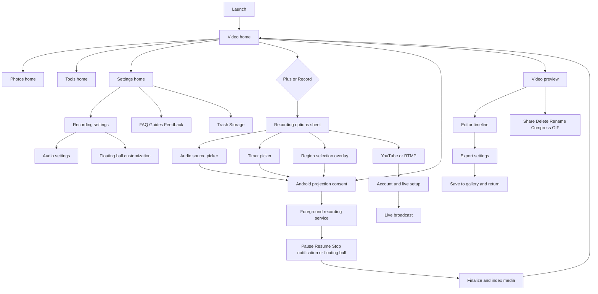

# XRecorder-Inspired Flutter Application — Complete Implementation Master Plan

**Status:** Implementation specification based on 89 supplied screenshots and four short reference videos.  
**Target:** Android-first Flutter application, integrating native Android components for screen capture, audio, overlays, and background work.  
**Design constraint:** Reuse the repository's existing theme, typography, tokens, widgets, navigation conventions, and state-management approach. Do not introduce a competing design system.  
**Product constraint:** Reimplement the observed behavior independently; do not copy proprietary code, logos, advertisements, premium branding, or third-party copyrighted assets.  
**Evidence notation:** `[###]` refers to the numbered screenshot in `UI_images.zip`. Screen names and details inferred from screenshots are marked **inferred**; items without visible implementation evidence are explicitly identified as proposed.

## 0. Mission, boundaries, and definition of complete

Build a usable screen recorder and lightweight media-editing suite, not a clickable UI prototype. Every visible actionable control must either perform the documented behavior or clearly explain that the capability is unavailable on the current device/Android version. No fake recording, fake export, placeholder file writes, fake account connections, or silently failing buttons.

**Feature coverage:** video library, photo library, record-start flows, regular/region/timed recording, projection consent, audio selection and mixing, screen orientation/quality, floating control ball, notification controls, pause/resume/stop, screenshot capture, annotation, touch indicators, facecam, recording tools, editor, trimming/splitting/merging, crop/rotate/speed/volume/text/music/background/filter, export, gallery sharing, file operations, recycle bin, storage, preferences, localization/theme, FAQ/help, feedback/diagnostics, live-stream account/settings and YouTube/RTMP publishing, voice effects, and premium/advertising gating if required by the product owner.

**Hard platform limits:** Android MediaProjection consent is controlled by the OS; capture can be blocked by secure content, DRM, protected windows, device policy, or app audio playback-capture policy. Region recording may need capture-then-crop unless supported by a platform-specific capability. Audio playback capture requires Android 10+ and consent/policy compliance. Camera and mic may be blocked while another app owns them. On Android 14+, each new projection session must use the appropriate consent and token lifecycle; never cache/reuse a one-time projection token. Overlay, notification, foreground-service, and background-activity restrictions vary by Android release. Do not promise bypasses.

**Release quality gate:** record a real screen, generate a playable media file, preserve and list it, edit/export it, share it, delete/restore it, and recover cleanly from interruption on at least the supported Android versions. All secondary actions have meaningful tests and error handling.

## 1. First action: audit the existing repository

Before editing any code, inspect `pubspec.yaml`, `android/`, manifest, Gradle configuration, existing theme and reusable widgets, app routing, dependency injection, state management, local storage, permission wrappers, test structure, CI, linting, and assets. Produce `docs/xrecorder/repository_audit.md` with (a) what exists, (b) components to reuse, (c) technical conflicts, (d) native feature gaps, (e) dependency licenses, (f) minimum SDK and target SDK constraints. Preserve the repository's conventions. Only add libraries after documenting why existing ones cannot cover the use case. Do not blindly overwrite AndroidManifest, Gradle, or theme configuration.

**Architecture proposal (adapt to repo):** presentation → application/controllers → domain/use-cases → repositories → local persistence/native adapters. Use the existing state-management framework; Riverpod/Bloc are alternatives, not requirements. Keep native platform services behind typed Dart interfaces so the UI remains testable. Persist durable recording state and media metadata; ephemeral sheet/dialog state stays local. Use typed routes, guarded navigation, and a single source of truth for active recording.

**Suggested structure, only if no equivalent exists:**

```text
lib/features/
  home/                 video_library/         photo_library/
  recording/            recording_settings/   floating_controls/
  annotation/           facecam/              media_preview/
  editor/               export/               media_tools/
  livestream/           recycle_bin/          storage/
  settings/             voice_effects/        help_faq/
  feedback/             account/              entitlement/
lib/core/
  navigation/  permissions/  design_adapters/  platform/
  media/  persistence/  errors/  localization/  diagnostics/
android/app/src/main/kotlin/.../
  recording/  projection/  audio/  overlay/  notification/
  facecam/  capture/  streaming/  device/
test/  integration_test/  docs/xrecorder/
```

## 2. Source evidence and coverage map

| Screenshot IDs | Feature / visible state | Implementation ownership |
|---|---|---|
| 001, 006–011, 061–065, 080, 085–086 | launcher, home video/photo tabs, recording active, preview, permissions, notification, overflow | home + recording + gallery |
| 002, 010, 037, 043–049, 060, 082, 084 | preview actions, editor timeline, export, tools, trim, item menu | editor + export + media operations |
| 003–005, 015–019, 025–036, 040 | settings, quick tools, themes, language, repair, capture and audio options | settings + native adapters |
| 007–008, 021–024, 026–027, 042, 077, 081, 088–089 | annotation, floating ball, guides, shake stop, mode/timer, warnings, audio picker, overlay permission | recording controls + help |
| 020 | voice changer presets, preview, premium locks | audio effects |
| 038–039, 041 | YouTube live account, broadcast form, troubleshooting | livestream |
| 012–014, 050–059, 066–076, 087 | feedback, issue report, FAQs, instructional help | support |
| 017, 044, 078–079, 083 | shortcut prompt, folder picker, trash, storage breakdown | file system + storage |
| 4 MP4 files | home-to-recording sequences, OS notification/quick-settings/overlay context | interaction validation |

The four videos show short real-device sequences rather than a complete walkthrough of every feature. Use screenshots as the primary source of screen inventory. Do not infer hidden screens or claim exact unobserved transitions without marking them as design decisions.

## 3. Navigation specification — routes, tabs, modal conventions

**Root shell:** `/home` with four primary destinations: `Video`, `Photos`, center `+` (action, not tab), `Edit`, `Settings`. Maintain selected destination and restore scroll position when switching tabs. Root back exits/OS default; nested back returns to the origin. Recording may continue across navigation and app backgrounding. Header: brand left, contextual premium/help/menu actions right. Bottom nav remains visible on primary destinations, hidden on fullscreen preview/editor, permission onboarding, FAQ detail and native system dialogs. Optional ad slot is outside scrollable content and collapses entirely if monetization is disabled.

**Routes:**

```text
/home/video                  /home/photos                 /home/tools
/home/settings               /media/video/:id             /media/photo/:id
/media/folder-picker         /editor/video?ids=...        /editor/image?ids=...
/editor/trim/:id             /editor/export               /settings/recording
/settings/audio              /settings/floating           /settings/voice-effects
/settings/theme              /settings/language           /settings/storage
/settings/trash              /settings/account            /settings/repair
/help/guides                 /help/faq                    /feedback
/feedback/issue-report       /live/setup                  /live/help
/live/broadcast              /entitlement                 /permissions/overlay
```

**Presentation rules:** full screen for pages; bottom sheet for tool chooser, timer, audio picker, quality, orientation, export options, and storage details; center dialog for theme, language, confirmation, mode, shortcut creation, shake stop, and stability warning. System dialogs (MediaProjection/overlay) remain OS-owned. Deep links must resolve to existing media IDs and handle missing/deleted files.

### 3.1 Exact user navigation graph



**Navigation transition contract:**

| Origin | Trigger | Destination / surface | Back / completion |
|---|---|---|---|
| Video home | bottom Photos | Photos home | bottom Video restores list |
| Video/Photos home | center `+` | recording options sheet [042] | dismiss to same tab |
| Video home | large Record | audio chooser [088] when configured, then projection consent [064–065] | cancel remains home; success records |
| Recording options | Record screen | audio chooser/permission → recording | completion indexes media and refreshes Video |
| Recording options | Record region | region overlay → projection consent → recording | cancel discards pending region |
| Recording options | Timed record | timer sheet [077] → countdown → consent/start | cancellation before start does not create file |
| Recording options | YouTube | live account setup [038] / broadcast [041] | close returns home; stop returns summary |
| Recording options | RTMP | RTMP setup (**proposed**, not pictured) | back returns chooser |
| Video home | item thumbnail | video preview [002, 062] | back to same scroll position |
| Video preview | Edit | editor [043–049] | back prompts discard if dirty |
| Video preview | Delete | confirm → trash | close preview; list updates |
| Video preview | Share | Android sharesheet | return to preview |
| Video home | scissors item action | trim editor [082] | save generates new media or chosen overwrite |
| Video home | item overflow | action menu [084] | action dispatch or dismiss |
| Photos home | photo item | image preview/editor (**inferred**) | back restores gallery |
| Tools home | Edit video / Merge | media picker [044] → editor | cancel returns Tools |
| Tools home | View video | video library or picker | return Tools |
| Tools home | Edit photo | picker → photo editor | return Tools |
| Tools home | Video GIF | picker → GIF converter | return Tools |
| Settings home | Recording options | recording settings [036] | back Settings |
| Settings home | Language / Theme | picker [015–016] | apply and remain Settings |
| Settings home | Trash | trash [079] | back Settings |
| Settings home | FAQ / Guide | FAQ [050–059] / Guides [073–076] | back Settings |
| Settings home | Feedback | feedback [087] | submit success then return |
| Settings home | repair | repair settings [019] | back Settings |
| Settings home | shortcuts | create-shortcut prompt [017] | dismiss Settings |
| Settings home | account | account menu [040] | logout with confirmation |
| FAQ | feedback CTA | feedback [087] | back FAQ with selected topic preserved |
| Feedback | report issue | issue steps [013–014] | upload/report result → Feedback |

## 4. UI assembly rules — reuse repo design system

**All sizes below are logical dp, not screenshot pixels; they are approximate starting values from reference compositions, not verified device measurements.** Validate at 360×800, 393×873, 412×915 dp, text scale 1.0–1.3, gesture navigation and three-button navigation. Respect SafeArea, system insets, keyboard and foldable/window resize. Do not hardcode screenshot device coordinates.

- Base horizontal content inset: 16dp; vertical section separation: 16–24dp; row padding: 12–16dp; inter-control gap: 8–12dp; group card radius: use theme token (reference approximately 12–16dp); modal top corner radius: 20–24dp; minimum tap target: 48×48dp.
- Primary home header approximately 52–56dp tall below status bar; four quick-tool icons evenly distributed in a row; circular touch area approximately 48–56dp; labels 11–12sp using existing caption token. Video list row approximately 76–96dp: 56–72dp thumbnail, metadata column, trailing menu and trim action. Record CTA full width minus 32dp, 48–52dp height, above bottom nav.
- Bottom navigation 56–64dp plus safe inset; five positions, center `+` outlined circular action about 42–48dp. Use repository nav component and active/inactive icon/color tokens. Main content scrolls beneath a fixed footer only if safe padding reserves the footer height.
- Settings: group headings 12–14sp, row minimum 52–64dp, leading icon 20–24dp, subtitle one/two lines, trailing chevron/switch/value. Radio pickers: row minimum 44–48dp. Settings screens show sections, not dense bordered tables.
- Recording tool sheet: 2×3 icon grid [004–005], 48–56dp icon circles, compact label; settings rows beneath. Mode/audio/quality sheets use scrollable options with a drag handle, clear selection state and sticky action when needed.
- Preview/editor: black/dark surface independent of app light theme; video preview uses aspect-ratio containment and letterboxing (never stretch). Editor top bar 48–56dp, preview uses remaining flexible height, playback seek bar and elapsed/duration labels, clip timeline 64–96dp, horizontally scrolling tool rail 64–80dp, export/Save at top right. Use fixed editor controls while preview resizes for keyboard or small screens.
- FAQ: horizontal scroll category chips 36–40dp tall; accordion cards with 12–16dp padding and 8–12dp gaps; bottom feedback pill 44–48dp. Help articles can show instructional illustrations from approved app assets, never from the reference app unless licensed.
- Trash/storage: top app bar 56dp; central empty-state icon/illustration and concise text; confirmation dialog 280–340dp wide; storage sheet shows donut/progress and category legend.
- Icons: use existing icon set first; map semantics to `videocam`, `image`, `add_circle_outline`, `edit`, `settings`, `brush`, `face`, `screenshot_monitor`, `sports_esports`/floating controls, `mic`, `volume_up`, `screen_rotation`, `timer`, `delete_outline`, `restore`, `share`, `content_cut`, `crop`, `rotate_right`, `music_note`, `text_fields`, `speed`, `filter`, `check`, `close`, `more_vert`, `chevron_right`, `help_outline`. Match optical size ~20–24dp and use semantic labels. If repo uses Lucide/custom icons, map to equivalent names rather than mixing icon families.
- Screenshot-specific composition differences: home with ad [085] vs no ad [009]; dark editor [043–049]; empty photo library [061]; video preview action overlay [002/062]; recording active red button [063]; large category tiles Tools [060]; compact feedback chips [087]; native OS overlay [064–065].

## 5. Data models and persistence contracts

```text
MediaItem { id, uri, kind(video|image|gif), displayName, mimeType,
  durationMs?, width?, height?, fps?, bitrate?, sizeBytes, createdAt,
  modifiedAt, folderUri?, thumbnailUri?, source(recording|edit|import),
  status(available|missing|trashed|processing), originalMediaId? }
RecordingSettings { mode, audioSource, internalVolume, micVolume,
  stereo, noiseReduction, echoControl, qualityPreset, width, height,
  fps, bitrate, orientation, countdownSeconds, showTouches,
  showFloatingBall, shakeToStop, keepScreenOn, hideNotifications,
  hideOverlayInCapture, screenshotOnStop, ... }
RecordingSession { id, startedAt, elapsedActiveMs, state, outputUri,
  configSnapshot, errorCode?, projectionGeneration, pauseIntervals }
EditProject { id, mediaIds, timelineClips, trimRanges, overlays,
  audioTracks, canvas, outputSettings, updatedAt, dirty }
TrashEntry { id, originalUri, trashUri?, deletedAt, expiresAt,
  originalMetadata, deletionMode }
LiveConfig { provider, title, description, visibility, endpoint?,
  credentialReference?, resolution, fps, bitrate, audioSource }
FeedbackDraft { category, subcategory, description, attachments,
  includeDiagnostics, consent }
Entitlement { feature, status, expiresAt?, source }
```

Use a local database compatible with the repo (e.g. Drift/SQLite or existing solution), and scoped-storage MediaStore/SAF for Android media. Persist settings atomically; migrations preserve old values. Never store projection tokens, passwords, stream keys, or OAuth tokens in plain preferences. Use Android Keystore-backed secure storage for secrets. Media metadata can be reindexed from MediaStore when app cache is cleared. Persist export jobs and reconcile unfinished work after process death.

## 6. Android-native subsystem: recording engine (highest priority)

### 6.1 Native service and Dart bridge

Implement a Kotlin `RecordingForegroundService` owning MediaProjection, encoder, audio pipeline, recording state machine, and notification. Flutter issues commands through a typed MethodChannel/Pigeon API; Kotlin publishes state/events through EventChannel or Pigeon callbacks. Commands: `checkCapabilities`, `prepareRecording`, `startRecording`, `pauseRecording`, `resumeRecording`, `stopRecording`, `cancelRecording`, `takeScreenshot`, `updateOverlay`, `getActiveSession`, `setAudioMix`, `getLastError`. Validate session ID and state on every command; commands must be idempotent where practical. Persist a session journal before opening output files. Native state is authoritative; Flutter UI subscribes rather than assuming success.

**States:** `idle → preparing → awaitingPermission → countdown → starting → recording ↔ paused → stopping → finalizing → completed`; any transient state may go to `failed`, then cleanup and return to `idle`. Do not allow duplicate start, stop after finalization, or stale callbacks to mutate a new session. Stop on MediaProjection `onStop`, process/service termination, revoked permission, encoder failure, or exhausted storage. Emit typed error and show recoverable user guidance.

### 6.2 Projection consent and capture

1. User chooses capture mode, audio and quality; validate capability, disk free space, permissions and notification requirements.
2. Start consent using `MediaProjectionManager.createScreenCaptureIntent()` from a visible Activity. Use the result only for this session; for Android 14+ follow the foreground-service and projection-token restrictions precisely.
3. Start/attach the foreground service with correct declared foreground-service types and platform-required permissions before obtaining/using projection as required by the OS version. Show an ongoing recording notification.
4. Create MediaProjection and register stop callback; configure `MediaCodec` AVC/H.264 baseline/main/high depending on device support, bitrate/fps/size; create `VirtualDisplay` feeding encoder input `Surface`. Use `MediaMuxer` or a well-supported native media pipeline to write MP4. Align width/height to encoder constraints and handle rotation according to settings.
5. On stop, drain encoder, write MP4 metadata/moov, close muxer, release display/projection/encoders, commit output to MediaStore, generate thumbnail and metadata, and publish completion. For interrupted files, attempt recovery or mark corrupt and explain.
6. For screen region, show draggable resizable rectangle overlay before starting; persist normalized rectangle; capture full display then crop through supported GPU/codec pipeline, or explicitly offer post-crop if live region capture is not viable. Ensure output coordinates map correctly through orientation and insets.
7. For timed recording, validate hours/minutes/seconds, show countdown, support cancel, and start only after valid projection consent; define whether timer means *start delay* (reference says scheduled start/countdown) rather than recording duration. Support separate duration limit only if product requires it.

### 6.3 Audio matrix [032–035, 088]

| Mode | Native capture | Behavior |
|---|---|---|
| Mute | no audio track | video only, no silent dummy microphone capture |
| Microphone | `AudioRecord` with supported source | mic gain, optional noise suppression/AEC where available |
| Internal | `AudioPlaybackCaptureConfiguration` + `AudioRecord` Android 10+ | captures only permitted app playback; show warning for protected/opted-out audio |
| Internal + microphone | two PCM sources mixed with gain control | resample to common sample rate, align timestamps, clamp/limit, AAC encode |

Implement mono/stereo options only when both capture and encoder support them. Sliders 0–100% map to gain values with tested perceptual behavior; avoid clipping when mixing two 100% sources. Audio timestamps must remain synchronized across pause/resume and orientation changes. Detect capture failures and display an actionable message. Noise reduction, echo control, and voice effects require supported DSP, not only toggle persistence.

### 6.4 Controls and resilience [006–011, 021–028, 063, 081]

Ongoing notification actions: pause/resume, stop, tools. Use immutable PendingIntents with unique session identity and secure exported component configuration. Floating ball: request `SYSTEM_ALERT_WINDOW` via system Settings; check `Settings.canDrawOverlays` on return; create `TYPE_APPLICATION_OVERLAY` window through a native service; drag/snap to edges, tap to expand radial or compact actions; show record status/timer, pause, stop, screenshot, brush, home/settings where allowed. Overlay may be excluded from capture only where OS/native composition supports it; otherwise explain limitation. `shake to stop`: accelerometer with threshold, debounce, confirmation option and screen-off considerations; do not stop accidentally. Touch indicator: overlay visualization of touch events cannot globally observe arbitrary app touches using normal app privileges; use Android developer 'Show taps' instructions or only annotate touches inside app, and do not claim global touch tracking. Screen orientation: auto, landscape, portrait; document resize/restart handling. Stability repair: battery optimization guidance and OEM-specific instructions, never promise the app can silently change device policy.

### 6.5 Facecam and annotation [007–008, 021, 025, 069]

Facecam: request camera, show a draggable circular/rounded preview overlay, resize, switch front/back if supported, handle camera busy, camera lifecycle, and rotation; if facecam must be *burned into recording*, composite camera frames into encoder surface using OpenGL/EGL or equivalent GPU pipeline; overlay visibility alone does not guarantee inclusion in captured MP4. Annotation: overlay canvas with pen, eraser, arrow, line, rectangle, circle, color palette, stroke width, undo/redo, clear, close; translate touch positions through overlay/window insets; composite drawing into recording if intended, otherwise label as live overlay only. Test stylus and multi-touch.

## 7. Video home, photo home, previews and file management

**Video home [006,009,063,085–086]:** load local recordings and imported videos using scoped MediaStore query and app output folder. Group by date, sort newest first, show thumbnail, duration, display name, resolution, size, optional NEW badge, overflow and scissors. Header storage pill opens storage summary [083]. Empty state is a real empty query. Tap thumbnail opens preview. Tap scissors opens trim mode. Large Record triggers recording flow. Active session replaces CTA with red elapsed time/stop surface; reflect native service state even after Flutter restart.

**Photos [061]:** same shell with Photos selected; MediaStore image query scoped to app folder by default, optional folder picker. Empty camera illustration centered. Thumbnail grid when images exist; tap opens preview; screenshot tool saves PNG/JPEG through MediaStore, updates gallery. Add filtering/sorting only where product requires it.

**Video preview [002,062]:** dark modal/fullscreen preview with native/player package selected after repo audit, playback, scrub, aspect fit, duration, thumbnail fallback. Overlay action row: delete, edit, trim, share. Closing preview stops/disposes player. Share via Android `ACTION_SEND`/sharesheet with `content://` URI and temporary read permission. Never share raw private filesystem paths. If file is missing, show repair/remove entry action.

**Item overflow [084]:** Edit → editor; Mute → produce derived muted file (do not mutate source silently); Compress → quality/bitrate preset export; Video to GIF → range/fps/scale selection, actual GIF encoder; Share → sharesheet; Rename → update display name with MediaStore-safe API and conflict handling; Delete → move to trash; optional Details → metadata. Confirm destructive actions and show progress.

**Folder picker [044]:** show XRecorder output folder and accessible MediaStore/SAF collections, Video/Photos tabs, search, selection count, thumbnail tiles, bottom selection strip, next arrow. Multi-select for merge; one-item select for edit. Request user-granted URI access where needed, persist URI permissions for SAF, handle revoked permissions. Never assume unrestricted `/storage/...` access.

**Recycle bin [078–079]:** distinguish app-managed trash from MediaStore system trash; avoid implying you can restore items deleted by unrelated apps. On supported Android, use MediaStore trash requests with system confirmation where necessary; otherwise move app-owned files into app-managed trash safely. Store original metadata, expiration time (reference says 24h), restore conflict policy, and permanent-delete confirmation. Empty state, restore, delete one, clear all, auto-purge worker. Auto-purge is best-effort and subject to OS scheduling; ensure stale entries are cleaned on app resume too.

**Storage [083]:** compute app video/image/cache/trash sizes, total device storage from platform APIs; display used/free and trash count. Avoid double counting files; show refresh and file cleanup action. Do not interpret entire device storage as app-owned.

## 8. Video editor — non-destructive timeline and export

### 8.1 Editor foundation [010,037,043–049,082]

Implement editor as project model separate from media originals. Preview playback clock drives playhead and clip timeline; user changes generate edit operations; undo/redo stack. Multi-clip timeline with ordered clips, trim-in/out, split at playhead, reorder, delete, add media, per-clip transforms, transition options if supported. Store projects and restore unfinished sessions. Display timecode and play/pause, horizontal scroll timeline, scrub with thumbnails generated asynchronously and cached. Export executes a deterministic render graph, not a screen recording of the preview.

**Engine decision:** evaluate Media3 Transformer, FFmpeg-based solutions and licensing/platform compatibility; choose based on actual required operations, current maintenance, size, codec support, and commercial distribution. Do not assume `ffmpeg_kit_flutter` is maintained or license-compatible. Consider Kotlin Media3 Transformer for standard operations, custom OpenGL for overlays/compositing, and native encoding for advanced operations. Validate HEVC input, variable frame rate, rotated metadata, 4K, HDR and audio channel behavior before claiming support.

### 8.2 Tool-by-tool contract

| Tool / screenshots | User interaction | Implementation |
|---|---|---|
| Trim [010,082] | drag start/end handles; preview selected range | update clip source in/out; validate minimum duration; export exact selected range |
| Cut / Split [082,043] | select playhead; split; delete segment | generate two clip references with shared original; ripple timeline when removed |
| Merge video/image [060,043–044] | choose multiple assets; reorder; duration for stills | concatenate via timeline renderer, normalize frame dimensions/fps/audio; transitions optional |
| Crop [037,043,048] | drag crop handles or choose aspect ratio | normalized crop rectangle; apply scale/letterbox with preview match |
| Rotate [037,046] | tap 90° increments | update rotation transform; output metadata or pixels consistently |
| Speed [049] | slider/presets | remap timestamps, time-stretch audio if supported; mute or warn for unsupported rates |
| Volume [043,049] | slider, mute | per-clip gain and fade; mix to final audio track |
| Text / watermark [043] | add text, drag, resize, duration | text overlay layer with position, fonts from repo, timing, renderer parity |
| Music [043] | select audio, trim, offset, gain | SAF picker, timeline audio track, permission persistence, licensing warning |
| Background / canvas [046–049] | choose ratio, color/blur/background | compose source within output canvas; GPU blur where supported |
| Filters [046] | select preset and intensity | color transform/LUT with deterministic output |
| Reverse / loop (**inferred**) | if toolbar supports it | reverse requires offline render; loop repeats clip references; only expose when implemented |
| Image edit [037,060] | crop, draw, rotate, text, save | bitmap pipeline with max decode bounds and EXIF preservation |
| GIF [060,084] | choose source interval, fps, width | decode sampled frames, palette quantization, encode GIF, show estimated size |
| Compress [084] | select target quality/size | estimate output, transcode with encoder capability fallback, compare size |
| Voice effects [020] | choose preset, preview, apply | DSP chain for pitch/formant/robot effects; preview rendered audio; premium gate if configured |

**Editor behavior:** Back with dirty changes opens Save draft / Discard / Cancel; export can run in background with persistent progress notification, cancel action and temp-file cleanup. Never overwrite originals without explicit consent. Export default creates a new MediaItem linked to original. Share exported output via URI. Thumbnail caches keyed by source content version and edit project parameters.

### 8.3 Export settings [045]

Resolution slider/choices SD 480p, HD 720p, FHD 1080p, 2K, 4K (only when device encoder and entitlement permit); fps choices 24/25/30/50/60 when compatible; remove watermark toggle only if app itself adds a watermark and product policy requires it. Show estimated file size with disclaimer. Start export validates disk, codec, output dimensions and permissions. Render to temporary destination; commit to MediaStore only after success. On cancel/failure delete partial file, preserve project, surface error and retry. Compare final duration, audio sync and playable output against preview. Do not mark premium presets available unless entitlement verified.

## 9. Recording settings and quick controls

**Main recording settings [028–036]:** top premium banner only if monetization exists; floating ball on/off; audio settings; video quality; orientation; recording mode; countdown; shake to stop; hide floating ball in screenshots, hide after recording, hide toast, hide only-one-app warnings where supported. Each setting is applied to a future recording; show explicit 'applies next recording' if not safe to change mid-session.

**Audio page [032–035]:** four source chips (mic/internal/mixed/mute), two gain sliders for mixed, one for single source, optional ducking, noise reduction and mono/stereo selection; unsupported controls disabled with reason. Save changes on selection or via existing repository convention; ensure recording uses exactly the persisted source.

**Quality sheet [031]:** UHD/4K, QHD/2K, FHD/1080p, HD/720p, SD/480p, 360p, Custom. Custom opens width/height/bitrate/fps picker (**inferred**). Query device encoder caps; disable unsupported selections. Record presets as configuration not just labels.

**Orientation [030]:** Auto, Landscape, Portrait; apply before projection and adapt on rotation. **Recording mode [027,029]:** Normal vs Performance. Performance lowers resource load via fps/bitrate/resolution/overlay restrictions with visible explanation; never claim it eliminates lag.

**Quick tools [004–005]:** screenshot, brush, facecam, region, timer, live. Row of quick setting shortcuts for audio, video, orientation, voice changer, hide floating ball. Tap each opens exact related picker; actions requiring permissions must present onboarding then resume original intent. **Floating customization [021–023]:** size/opacity sliders, default/custom style, show time, expanded control layout, overlay hide behavior. Changes preview immediately if overlay active; persist when leaving.

**Voice effects [020]:** Original, Child, Woman, Uncle, Robot, Old Man, Monster presets as visible; some marked PRO. Record short sample via mic after permission, preview original/processed, save selection, apply to recorded microphone track or editor track according to explicit scope. Don't promise modification of arbitrary other-app audio. Premium access requires real entitlement infrastructure or hide PRO gating for a free clone.

**Theme/language [015–016]:** System/Light/Dark; automatic locale and listed languages (English, Portuguese, Spanish, Russian, Indonesian, Turkish, Arabic, Bengali, German, French, Italian, Japanese, Korean, etc.) only if translated resources actually exist. Support RTL for Arabic. Persist settings and rebuild app without losing active session. Do not list untranslated languages as complete.

**Other settings [003,017–019,025,040]:** storage path via SAF and safe app-owned folder migration; trash retention; shortcut creation using Android pinned shortcut APIs with launcher support check; FAQ/Guides; feedback; account/logout; UI repair/accessibility settings; auto repair; prevent abnormal stops, subject to OS restrictions. Account only if needed for livestream/subscription. Screenshot [017] proposes home-screen shortcuts for video/photo editor, not automatic creation without user approval.

## 10. Livestream — YouTube and RTMP [038–039,041–042]

**YouTube flow:** recording sheet → YouTube → authenticated account screen (or sign-in) → create live broadcast form (title max 100 chars, description, public/unlisted/private visibility) → preflight (channel eligibility, API permissions, network, encoder) → create broadcast/stream and bind → start encoder/network publishing → active live controls → stop → finalize YouTube broadcast and show result. The screenshot's YouTube eligibility help warns that livestream privileges may need activation and delay; show a real actionable error, not an indefinite spinner.

**Authentication:** OAuth 2.0 authorization code with PKCE/system browser and supported Google identity flow, least-privilege YouTube scopes, secure token storage, refresh and revoke/logout. Do not request user password. YouTube Live Streaming API integration must use current provider documentation, project verification/quota and terms. Broadcast creation and stream binding require API capability and channel eligibility. Provider-side stream settings may change.

**RTMP:** custom RTMP/RTMPS server URL + stream key, validation, encrypted secret storage, connection test, reconnect policy, encoder H.264/AAC output and RTMP muxing. Do not log stream keys. For network drops: exponential backoff, visible reconnect state, local recording fallback if opted in, stop after configured retry budget. Separate broadcast lifecycle from local recording lifecycle. RTMP is shown as a menu entry [042], but its configuration screen is not pictured, so this is an explicit implementation design decision.

**Live settings [040]:** account, sign-out, microphone/internal audio, resolution, quality, FPS, bitrate and Help. Validate actual platform restrictions before live start. If livestream is out of scope for initial release, feature flag it as not shipped, never present a nonfunctional 'Start Live' button.

## 11. Help, FAQ, feedback and issue reporting

**FAQ [050–059,066–072]:** searchable/scrollable categories All, Troubleshooting & Lag, Audio, plus visible sections Recording, Privacy, Registration, Save & Share, Video. Each question is an accordion with expandable explanation; only one or multiple open based on existing app pattern, but keep behavior consistent. Data should be localization-ready and stored as structured content, not one enormous widget. Specific observed topics: lag, missing saved video, share failure, black screen, video/audio sync, missing internal audio, noise, orientation, recording Zoom/Google Meet, recording region, facecam, recording time, start/stop and privacy. Do not present technical instructions that conflict with current Android behavior. Add feedback CTA to prefill issue category.

**Guides [073–076]:** accordion sections for start/stop via notification, floating ball, in-app record, audio source, region, timed recording, facecam, orientation and conferencing apps. Illustrations/steps are tutorial content, not operational recording controls. Use approved recreated diagrams; ensure accessible alt text.

**Feedback [087]:** category chips (Recording, Audio, Screenshot, Playback, Editing, Other), subcategory chips (stop unexpectedly, lag, cannot start, system error, cannot save, etc.), multiline description, add image/video/log attachment, send button disabled until valid. Attachments must use user-selected URI; size limit, MIME checks, privacy notice and explicit diagnostics consent. Provide backend delivery endpoint or mail fallback, retries, offline draft and success receipt. Never claim a report was sent without server confirmation.

**Issue report [012–014]:** three-step wizard: Start → reproduce issue → stop and upload logs. Include only diagnostic logs collected during opt-in session; redact tokens, stream keys, personal media paths and sensitive metadata. Show size and upload progress, cancellation, and cleanup after success. The screenshot shows a mail-compose flow with log attachment; if using email intent, acknowledge that user must send the email in the mail app and the app cannot verify delivery. Separate 'send feedback' from 'upload diagnostics'.

## 12. Permissions, privacy, security and monetization

| Permission/capability | When requested | Degraded behavior |
|---|---|---|
| MediaProjection consent | each recording session as OS requires | cannot start capture; remain on origin screen |
| Microphone | select mic/mixed audio, voice sample | offer internal-only/mute |
| Camera | enable facecam | recording still works without facecam |
| Overlay access | enable floating ball/annotation | in-app and notification controls remain |
| Notifications | when needed for recording status/actions | explain OS restrictions; maintain required foreground notification behavior |
| MediaStore/SAF URI access | importing/editing external files | allow app-owned files; show picker |
| Network | livestream, feedback, remote help, ads | offline recording/editor work |
| Battery optimization exemption | optional, only when justified | show manual OS guidance; no forced exemption |

Use minimum privileges, explain capture of sensitive on-screen content and audio, show persistent recording indicators, honor OS consent, provide privacy policy and data deletion. Do not use accessibility service to secretly capture taps or bypass Android security. Encrypt account credentials. Keep logs bounded and redact PII. If shipping ads/premium: isolate ad slots and entitlements behind adapters, ensure recording never depends on ad loading, and implement purchase verification/restoration before gating PRO features. Screenshots alone do not specify a billing backend or ad provider; both require product decisions.

## 13. Operational flow contracts (implementation-level)

### Flow A — first recording

1. Launch `/home/video`; initialize repositories and query native session state; display permission-agnostic home.
2. User taps Record; if preferred audio is unset show [088]; otherwise proceed with persisted selection.
3. Validate recording mode, output destination, disk, codec, mic permission if needed, and any feature-specific overlay/camera permissions. Only request each permission when feature is invoked.
4. Launch OS projection prompt [064–065]. Cancel → close prompt and restore home, with no orphan service or file. Accept → create native session and notification.
5. Transition `starting → recording`; show active red timer [063] and floating/notification controls if enabled.
6. Pause/resume adjusts active duration and encoder timestamps; stop from any surface sends one native stop command.
7. Finalize output; insert MediaStore record, update library, generate thumbnail, show optional preview [062]. If stop fails, show recovery option and retain partial-file diagnostic record.

### Flow B — recording outside the app

Start as above → Home/another app → foreground service remains alive → notification [011] and floating ball [006] operate without Flutter Activity → stop action finalizes media → user taps completion notification → deep-link to new preview. If app process is killed, service must either safely continue within OS constraints or finalize/mark session interrupted; never display a fabricated 'recording' state after service death.

### Flow C — timed/region recording

`+` → mode sheet [042] → Timed [077] → select countdown → confirm → obtain projection consent at an OS-compliant point → show countdown with cancel → start; or `+` → Region → overlay region selector → confirm rectangle → projection consent → start. Preserve region orientation and scale; on unsupported devices explain fallback to full capture plus crop.

### Flow D — edit and export

Home video item → preview [062] → Edit → project creation → timeline [043] → choose tool → modify draft → Save [045] → choose supported resolution/fps → export job → progress → MediaStore commit → new item in Video list → preview/share. On failure return to editor with all edits preserved. Back before export offers save draft/discard/cancel.

### Flow E — file trash/restore

Video item menu [084] → Delete → confirmation → move to app/system trash → remove from active query → Settings → Trash [079] → select item → Restore → resolve duplicate name/path → update MediaStore and gallery; or Clear Trash [078] → explicit permanent-delete confirmation → delete all eligible entries and update storage.

### Flow F — support report

Settings → FAQ [050] → expand question [057] → Feedback [087] with category prefilled → description and optional attachments → submit → success/failure. For diagnostic reproduction: Feedback → Report issue [013] → Start [014] → collect consented logs while user reproduces → Stop & upload → progress → server/mail handoff and confirmation.

### Flow G — live publishing

`+` → YouTube → sign-in/setup [038] → eligibility check/help [039] if blocked → broadcast title/description/privacy [041] → preflight → start → publish status and stop controls → end stream, release projection/audio/encoder and update result. RTMP follows analogous flow with custom endpoint and key.

## 14. Delivery phases, dependencies and acceptance criteria

| Phase | Work packages | Must pass before next phase |
|---|---|---|
| P0 Repo audit | design tokens, SDK/dependencies, test setup, capabilities matrix, route skeleton | no theme duplication, clean build, baseline tests |
| P1 Shell and data | root tabs, video/photo lists, storage model, thumbnails, file picker, empty states | actual MediaStore assets load, navigation restores state |
| P2 Recording MVP | projection, service, H.264 MP4, mic/mute, notification stop, native state | 5-min real recording plays with correct duration; stop outside app works |
| P3 Advanced recording | internal/mixed audio, pause/resume, timer, region, orientation, quality, floating ball | A/V sync and permission/error tests pass |
| P4 Capture tools | screenshot, facecam compositing, annotation, touch guidance, shake stop | features work on real hardware; restrictions documented |
| P5 Media management | preview, share, rename, delete/restore, storage, compression | URI safety and no data loss under failures |
| P6 Editor foundation | project, timeline, trim/split/merge, crop/rotate, export | non-destructive edit roundtrip passes |
| P7 Editor advanced | audio mix, speed, text, music, filters, background, GIF, voice effects | output matches preview and remains in sync |
| P8 Settings/help | full settings, quick tools, language/theme, FAQ, guides, feedback | every visible control wired, accessibility checked |
| P9 Livestream | OAuth, YouTube API, RTMP/RTMPS, reconnect and lifecycle | verified private/unlisted test broadcast on real account |
| P10 Release | battery/storage/interruptions, compatibility, security, license audit, CI | release checklist signed; no critical crashes or fake features |

Parallelization: UI shell + help content can proceed alongside native recording; editor research and codec capability probing can begin early; full editor depends on stable media repository; livestream depends on reliable capture/audio service. Gate advanced functionality by device capability and feature flags, not arbitrary screenshot order.

## 15. Test matrix and measurable acceptance

**Unit:** settings migrations, audio mode mapping, recording state transitions, timestamp math, timer validation, storage arithmetic, trash expiration, route guards, project undo/redo, trim/split ranges, export preset validation, feedback form. **Widget/golden:** video/photo empty and populated states, active recording, quick tools sheet, picker variants, FAQ expansion, settings radio sheets, editor controls, small-screen and large text. Reuse repository golden harness and design tokens.

**Android instrumentation / integration:** OS projection accept/cancel; Android 10/11/12/13/14/15+ representative devices where available; overlay allowed/denied; mic allowed/denied; internal capture allowed/blocked; notification action while Activity absent; phone lock/unlock; incoming call; app background/foreground; rotation; low disk; encoder initialization failure; projection revoked; process/service restart; Bluetooth headset changes; screen secure content; 30–60 minute recordings; thermal throttling; low RAM; 720p/1080p/4K where supported; mono/stereo; long export; GIF; SAF revoked permission; deletion/restore and duplicate filenames; network interruption and YouTube quota/auth errors.

**Minimum exit assertions:**

- 100% of shipped visible controls have real handlers and defined success, cancel and failure states.
- Recording lifecycle has no duplicate active sessions and no permanently stuck `finalizing` state.
- Saved output is discoverable and playable by another Android media player; actual metadata matches chosen settings within codec/platform tolerances.
- Pause/resume yields monotonic timestamps and no audible discontinuity beyond documented constraints.
- Editor never changes source media unless user explicitly approves; failed export preserves project and original.
- Recycle-bin actions never silently delete outside app-owned or user-authorized media.
- Projection/overlay/recording state remains accurate when Flutter UI is destroyed and recreated.
- All runtime permissions are requested just in time; denial does not cause crash or false success.
- Screen-reader labels, minimum targets, keyboard focus, RTL, and text scaling work.
- All included dependencies, media codecs and external SDKs pass distribution-license review.

## 16. Task decomposition for an implementation agent

For each feature, execute this exact loop: (1) locate existing analogous code/theme components; (2) write route + UI state + domain interface; (3) implement real repository/native adapter; (4) connect permission/capability handling; (5) implement loading/empty/error/cancel/permission-denied states; (6) add unit/widget/integration tests; (7) run format/analyze/tests and Android build; (8) verify on emulator and hardware; (9) document supported behavior and limitations; (10) mark complete only when acceptance tests pass. Do not generate dozens of disconnected mock screens in one pass.

**Suggested task IDs:**

```text
AUD-01 repository inventory and theme reuse
ARC-01 routes and typed navigation
DAT-01 MediaStore repository and metadata database
DAT-02 SAF media picker, thumbnails, caching
HOME-01 video home; HOME-02 photos; HOME-03 tools
REC-01 projection lifecycle; REC-02 foreground service; REC-03 codec/muxer
REC-04 notification controls; REC-05 audio sources; REC-06 audio mixer
REC-07 pause/resume; REC-08 timer; REC-09 region; REC-10 orientation
REC-11 quality; REC-12 floating overlay; REC-13 facecam compositing
REC-14 annotation; REC-15 screenshots; REC-16 shake-to-stop
MED-01 video preview; MED-02 share/rename; MED-03 trash/restore
MED-04 storage; MED-05 compress; MED-06 GIF
EDT-01 project model; EDT-02 timeline; EDT-03 trim/split/merge
EDT-04 crop/rotate; EDT-05 speed/volume; EDT-06 music/text
EDT-07 filters/background; EDT-08 export worker; EDT-09 image editor
SET-01 recording settings; SET-02 audio; SET-03 floating customizations
SET-04 theme/language; SET-05 repair/shortcuts; SET-06 voice effects
SUP-01 FAQ; SUP-02 guides; SUP-03 feedback; SUP-04 diagnostics
LIVE-01 YouTube OAuth; LIVE-02 API broadcast; LIVE-03 RTMP
LIVE-04 network/reconnect; ENT-01 entitlement (conditional)
QA-01 integration matrix; QA-02 performance; QA-03 privacy/security
QA-04 license/release audit
```

For every task PR include: referenced screenshot IDs, routes affected, state/data changes, native interfaces, permission matrix, test evidence, and known limitations. Mark screenshot-driven guesses as assumptions requiring product confirmation.

## 17. Open product decisions and assumptions

1. **Android only vs iOS:** screenshots are Android and core behavior relies on Android APIs. iOS requires a distinct ReplayKit Broadcast Upload Extension and cannot replicate Android floating overlays/notification controls. Android-first is the only evidence-grounded scope.
2. **Repo unknown:** no source repository was supplied, so actual widget names, existing theme tokens, navigation package, current dependencies and exact integration points cannot be specified yet. Audit them before code generation.
3. **Ads/PRO:** reference screenshots show ad banners and PRO badges, but no entitlement implementation. Choose free-only, subscription, or one-time purchase before shipping monetization UI.
4. **YouTube eligibility:** requires real provider account, OAuth app, quota, consent configuration and potentially channel enablement; not testable purely from screenshots.
5. **Voice changer scope:** decide live microphone processing, post-production processing, or both; each needs different DSP/encoder integration.
6. **Touch visualization:** global touch indicators cannot be assumed available to an ordinary Android app; provide supported alternatives and truthful guidance.
7. **Region capture:** decide live crop pipeline versus full-screen capture plus post-crop fallback.
8. **Export engine:** select after legal and codec benchmarking; no assumption that an old FFmpeg plugin is safe for release.
9. **Storage path:** reference uses a traditional shared-storage path, but modern Android requires MediaStore/SAF-safe access.
10. **FAQ translations and artwork:** screenshot content is Vietnamese; English specification does not imply localized content has been translated or artwork licensed.
11. **Missing screens:** RTMP setup, detailed photo editor, premium purchase, export progress, post-live summary and several error screens are not pictured; their behaviors above are explicit design proposals, not claimed observations.

## 18. Completion checklist

- [ ] All screenshot-represented destinations mapped to routes or OS-owned dialogs.
- [ ] All tabs, menus, buttons, sheets and settings wired to real behavior.
- [ ] Android capture works with OS-consented projection and resilient foreground service.
- [ ] Microphone, internal, mixed and mute capture correctly handle support and denial.
- [ ] Floating, notification and in-app controls share one native session state.
- [ ] Timed/region/facecam/annotation/screenshot features have verified output behavior.
- [ ] Library, preview, media picker, share, rename, trash, restore and storage work.
- [ ] Editor supports non-destructive operations and playable export.
- [ ] All premium/advertising and streaming surfaces are either real or hidden by scope.
- [ ] Settings persist, help is actionable, and feedback respects privacy.
- [ ] Release builds pass integration, performance, security, licensing and accessibility checks.

---

### Final instruction to Codex / implementation team

**Treat this document as a functional and navigation specification, not a mandate to recreate screenshots pixel-for-pixel.** Reuse the existing repository design system and component library. Begin with a repository audit, then implement and verify each phase in dependency order. Preserve existing working code and tests. Do not invent platform capabilities, fake successful operations, or ship UI controls that do nothing. If a feature is not technically feasible on a device or under Android policy, implement a truthful disabled state and supported fallback. Update the feature matrix and screenshot-to-route traceability after each milestone.
