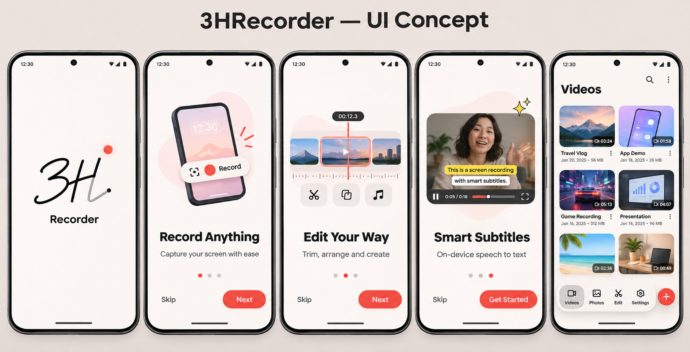
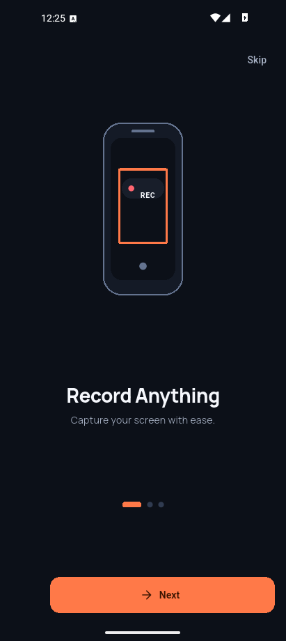
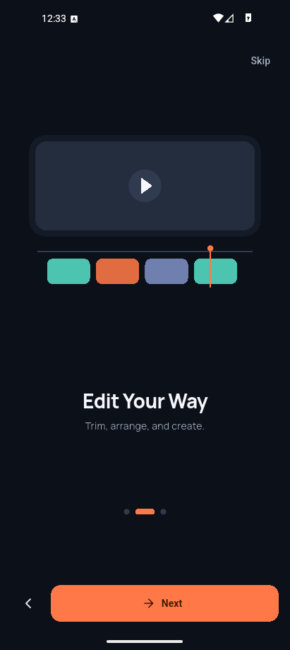
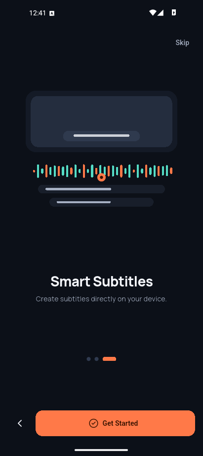
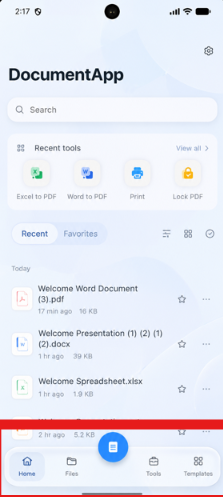
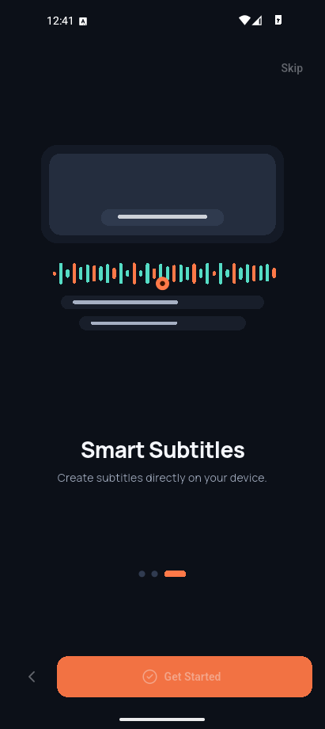

# TASK UI/UX 02B - Consolidated historical report

Merged on 2026-11-11 from the four original reports. Historical statuses and limitations are preserved; these are not validation results for the current source. Device-private backups remain local and Git-ignored.

[Summary](#summary) | [Visual QA](#visual-qa) | [Tests](#tests) | [Storage](#storage)

## TASK UI/UX 02B — Báo cáo cuối

Ngày: 2026-11-10  
Kết quả: **PARTIAL** — phần UI độc lập đã được triển khai; analyzer, test, build và visual QA sau thay đổi chưa hoàn tất do tiến trình Dart treo và hệ điều hành từ chối dừng tiến trình. Không có AVD hoặc dữ liệu QA nào bị tác động.

### Thay đổi

- Onboarding dùng ba PNG riêng: điện thoại ghi hình, filmstrip/timeline, media preview với subtitle và playback. Có nhãn REC nằm trên pill, semantics vẫn lấy từ localization. Ảnh được decode theo chiều rộng thiết bị (giới hạn 1200 px), chuyển động fade/scale nhẹ và đứng yên khi Reduce Motion.
- Bottom navigation chuyển selected pill bằng AnimatedPositionedDirectional bên trong capsule đã clip. Chuyển trạng thái icon/label 180 ms, về 0 khi Reduce Motion. Bốn route, selected index, Create callback, bàn phím ẩn bar và hành vi reselect-to-scroll-top được giữ nguyên.
- Splash Light dùng nền warm white; Android 12+ nhận wordmark Recorder raster 4× từ Manrope ở cả Light và Dark. 3H vẫn là vector sharp với nét 3 rồi H. Flutter splash không thêm thời gian chờ.
- Onboarding và splash theo theme Flutter hiện hành. Không đổi SettingsController/schema/default hoặc code shared native initialization; chỉ tinh chỉnh resource hiển thị splash. Không đổi MainActivity capture logic.

### Trạng thái chấp nhận

| Hạng mục | Trạng thái | Bằng chứng |
|---|---|---|
| Artwork onboarding | IMPLEMENTED / runtime chưa xác minh | PNG nguồn và widget kiểm tra asset đã thêm |
| Splash | IMPLEMENTED / visual QA PARTIAL | XML hợp lệ; chưa build/capture sau thay đổi |
| Navigation | IMPLEMENTED / visual QA PARTIAL | Pill nằm trong clip; widget test 320dp RTL + text scale 2 được thêm, chưa chạy |
| Theme mặc định mới | WAITING FOR P1 APPROVAL | SettingsController hiện default Dark; không tự đổi semantics |
| P1 boundary | PRESERVED | Không sửa MainActivity, settings semantics, capture, permission hay encoder |
| Bảo toàn dữ liệu | PASS | Không chạy ADB; không đụng media, QA profile, app data hoặc build artifacts |
| TASK10 | NOT STARTED | Không triển khai |

### Ma trận theme

| System theme | Preference đã lưu | Flutter sau khi restore | Android splash trước Flutter | Tình trạng |
|---|---|---|---|---|
| Light | System | Light | Light | Đúng khi preference System đã được lưu; chưa kiểm tra AVD |
| Dark | System | Dark | Dark | Đúng khi preference System đã được lưu; chưa kiểm tra AVD |
| Dark | Light | Light | Dark | Có thể lệch ở handoff; cần native đọc preference, chờ Người 1 |
| Light | Dark | Dark | Light | Có thể lệch ở handoff; cần native đọc preference, chờ Người 1 |
| Light hoặc Dark | Không có preference (fresh install) | Hiện default Dark | Theo System | Không đạt đề xuất Follow System; chờ P1 approval, không tự đổi default |
| Bất kỳ | Preference hiện hữu | Được giữ nguyên | Theo System trước khi Flutter khởi tạo | Không reset/migrate lại settings trong TASK 02B |

### Việc còn lại

1. Khi Dart toolchain hoạt động, chạy dart format, focused onboarding/navigation tests, Flutter analyzer và Android debug build.
2. Cài cập nhật bằng install-replace trên đúng AVD QA đã được xác minh; không clear data. Chụp Light/Dark, ba trang onboarding và từ đầu đến frame splash hoàn tất; xem lại video.
3. Chạy thử tab/reselect, Create sheet, bàn phím, 320dp, RTL, scale 2, touch targets, TalkBack và kiểm tra new-install theme bằng fixture/profile cô lập.
4. Người 1 quyết định đổi default theme sang Follow System và cơ chế đồng bộ native splash với app preference.

Không có kết luận visual parity từ ảnh AVD cũ hoặc từ widget/source preview.

Chi tiết: [Visual QA](#visual-qa), [Test Evidence](#tests), [Storage](#storage).

---

## TASK UI/UX 02B — Visual QA

### Gap list trước khi sửa

- **Splash:** 3H vector có thứ tự 3→H nhưng Android splash thiếu wordmark; nền Light xanh lạnh, chưa gần warm-white reference. Flutter splash có Recorder nhưng chưa có bản ghi trọn vẹn sau TASK 02B.
- **Onboarding 1 — Record:** CustomPainter phẳng, thiếu thiết bị/media depth và pill REC giàu chi tiết.
- **Onboarding 2 — Edit:** thiếu thumbnail filmstrip có nội dung, trim handles và hierarchy của editor.
- **Onboarding 3 — Subtitles:** thiếu media-preview kiểu ảnh/video thực, playback controls và chiều sâu.
- **Navigation:** AVD hiện chỉ có Dark evidence; selected fill nằm riêng theo tab, chưa chứng minh pill trượt và Light appearance. Cần giữ capsule, Create riêng và phần ngoài hoàn toàn trong suốt.
- **Theme đầu tiên:** code Settings hiện mặc định Dark; không theo System Light. Đây là thay đổi semantics Settings và đang chờ Người 1.

### So sánh reference và ảnh AVD đã có

Các ảnh AVD bên phải đều là **baseline trước TASK 02B**, không phải ảnh sau patch. Cột “02B sau” được để trống khi không có bằng chứng runtime mới.

#### Onboarding

| Reference Light | AVD trước 02B — Dark | AVD sau 02B |
|---|---|---|
|  |  | Chưa chụp: APK mới chưa build/cài |
|  |  | Chưa chụp: APK mới chưa build/cài |
|  |  | Chưa chụp: APK mới chưa build/cài |

Artwork mới có thể xem riêng; đây là preview asset, không phải screenshot app:

- [Record Anything](../../assets/images/onboarding/record_anything_v1.png)
- [Edit Your Way](../../assets/images/onboarding/edit_your_way_v1.png)
- [Smart Subtitles](../../assets/images/onboarding/smart_subtitles_v1.png)

#### Splash

| Reference / mục tiêu | AVD trước 02B | AVD sau 02B |
|---|---|---|
| [Board reference](UI/onboarding.png), [video motion reference](UI/splask.mp4) | [Cold-start recording](TASK_UI_UX_02_EVIDENCE_20261110_121400/splash_cold_start.mp4), [native vector recording](TASK_UI_UX_02_EVIDENCE_20261110_121400/splash_animated_vector.mp4) | Chưa ghi lại toàn trình tự sau patch; native wordmark và nền mới chưa quan sát trên AVD |

#### Bottom navigation

| Reference Light | AVD trước 02B | AVD sau 02B |
|---|---|---|
|  |  | Chưa chụp |
|  | [Ảnh Photos Dark](TASK_UI_UX_02_EVIDENCE_20261110_121400/nav_photos_dark.png), [Create sheet](TASK_UI_UX_02_EVIDENCE_20261110_121400/nav_create_sheet_dark.png) | Chưa chụp |

Không có ảnh AVD Light từ TASK 02 hoặc TASK 02B; AVD có persisted Dark app preference. Không đổi preference để tránh sửa trạng thái QA.

### Quan sát code sau patch

- Pill có 4 dp lề trong padding của capsule và được clip; outside container không có DecoratedBox/background.
- Blur sigma 10 vẫn bị giới hạn bởi ClipRRect; không có animation blur liên tục.
- Create giữ callback cũ; tab indices 0–3 và reselect-to-scroll-top trong StudioShell không đổi. Navigation ẩn khi keyboard inset lớn hơn 0.
- Ảnh artwork là 1200×800 RGBA, không có copy/logo/watermark nhúng; pill REC là text overlay, có semantics của trang không trùng.
- Light splash/onboarding dùng #FAF9F6 riêng cho hai surface này; không đổi palette toàn app. Dark giữ màu nền hiện hành.

### Visual coverage còn thiếu

Chưa được xác minh sau patch: AVD Light/Dark screenshots, 3 onboarding pages, pill transition, full cold splash video đến completed mark, warm launch, system/app theme handoff, keyboard, short/tall runtime layouts, actual touch hit testing, TalkBack, Reduce Motion qua Android setting. Existing UI/UX 02 screenshots/videos là baseline lịch sử, không được dùng làm bằng chứng sau patch.

---

## TASK UI/UX 02B — Test Evidence

### Kiểm tra đã thực hiện

| Kiểm tra | Kết quả |
|---|---|
| Đọc AGENTS.md, local instructions, UX guidelines, UI/UX 01/02 reports, references và source liên quan | PASS |
| git diff --check | PASS, chỉ có cảnh báo line-ending đã tồn tại ở studio_shell.dart |
| Parse 13 Android XML resource/theme/animator files bằng System.Xml.XmlDocument | PASS |
| Kiểm tra kích thước asset | PASS: 3 ảnh onboarding 1200×800; 2 wordmark 608×192 |
| Rà soát route/index/callback/reselect logic | PASS qua source inspection; runtime regression chưa xác minh |
| Rà soát P1/data boundary | PASS qua status/diff inspection; không thao tác ADB |

### Không kết luận

- dart format trên 4 file Dart không trả output sau 60 giây; phiên shell được ngắt bằng Ctrl+C và trả exit 1, nên không thể xác nhận format đã hoàn tất hay không.
- flutter analyze --no-pub trước đó không trả output hoặc exit code trong 30.9 giây.
- Một tiến trình Dart PID 12444 vẫn tồn tại (system StartTime hiển thị 09:33, trước lượt kiểm tra này; origin/owner không xác định). Lệnh Stop-Process bị Windows từ chối với Access is denied. Không thử dừng lại, không yêu cầu quyền cao hơn, không lách giới hạn. Vì local harness yêu cầu Flutter CLI chạy tuần tự, chưa khởi chạy test/build Flutter khác khi tiến trình còn tồn tại.
- Focused onboarding/startup/navigation tests mới **chưa chạy**; test changes chưa được xác minh.
- Android debug build và install chưa chạy. Không cài APK cũ thay cho code mới.
- Không dùng AVD trong lượt 02B; QA5570/user data giữ nguyên. Screenshots/videos của TASK UI/UX 02 là baseline cũ, không phải kết quả sau thay đổi. MainActivity vẫn có thay đổi uncommitted từ UI/UX 01/02; không chỉnh file này trong lượt 02B. SettingsController không bị sửa.

### Test được thêm nhưng chưa chạy

- Onboarding test xác nhận mỗi page chọn đúng PNG và Reduce Motion giữ artwork ổn định.
- Navigation test 320dp, RTL Arabic, text scale 2: kiểm tra selected pill nằm trọn trong capsule, tab targets tối thiểu 48dp và Create 52dp.
- Existing tests về persistence, Skip/Get Started, swipe/Back, startup và Create callback được giữ.

### Hạn chế

Analyzer/test status là **INCONCLUSIVE**, không PASS hoặc FAIL. Các thay đổi Dart cần analyzer/test/build trước khi merge. XML parsing không chứng minh Android resource linking; source inspection không chứng minh visual/runtime behavior.

---

## TASK UI/UX 02B — Storage Report

### Trước và sau

| Hạng mục | Trước 02B | Sau 02B | Trạng thái |
|---|---:|---:|---|
| Toàn bộ build/ | 140,033,768,082 B theo lần đo UI/UX 02 | Chưa quét lại | Không chạy build; tránh quét lại cây build khoảng 140 GB |
| build/uiux02/ | 1,295,682,808 B theo lần đo UI/UX 02 | Chưa đo lại | Không tạo APK/intermediate mới |
| Free space D: | 32,418,328,576 B theo lần đo UI/UX 02 | Không đọc được | Get-Volume và fsutil đều trả Access is denied |
| Artwork onboarding mới | 0 B trước 02B | 3,098,488 B | Đo trực tiếp |
| Native wordmarks Light/Dark | 0 B trước 02B | 9,232 B | Đo trực tiếp |
| Evidence tham chiếu UI 02B | 0 B trước 02B | 2,995,201 B | 6 file; đo trực tiếp |
| Flutter/Android build growth | — | Không có artifact mới được tạo | Không có build hoàn tất |

Không khẳng định dung lượng build/free-space sau bằng chính xác số đo cũ. Tổng asset/evidence đo trực tiếp là **6,102,921 B (~5.82 MiB)**; bốn báo cáo mới thêm khoảng **14 KB**, nên tổng task artifacts khoảng **6.12 MB**. Không tạo screenshot/video AVD mới ở lượt này.

### Asset

| Nhóm | Kích thước | Định dạng | Ghi chú |
|---|---:|---|---|
| onboarding/*.png | 3,098,488 B | PNG alpha, 1200×800 | Ba ảnh riêng, tối ưu/downsample từ 1536×1024 |
| splash wordmarks | 9,232 B | PNG alpha, 608×192 ở drawable-xxxhdpi | Manrope nội bộ, tương đương density 4× |
| review reference frames + HTML helper | 2,995,201 B | PNG/HTML | Không phải QA AVD mới |

Artwork onboarding được tạo bằng ImageGen cho dự án từ reference board làm nguồn cảm hứng; không dùng asset bên thứ ba, không nhúng chữ/logo/watermark. Không kèm giấy phép OSS riêng; quyền sử dụng theo điều khoản dịch vụ tạo ảnh hiện hành. Wordmark raster dùng Manrope hiện có trong repo; font đi kèm SIL Open Font License 1.1 ở assets/fonts/OFL.txt.

### Bảo toàn

Không xóa, di chuyển, nén hay sửa build output, evidence QA cũ, AVD, media, drafts, settings, model hoặc dữ liệu người dùng. Không chạy flutter clean/gradle clean. Disk free sau task chưa xác minh do quyền đọc volume bị từ chối.
