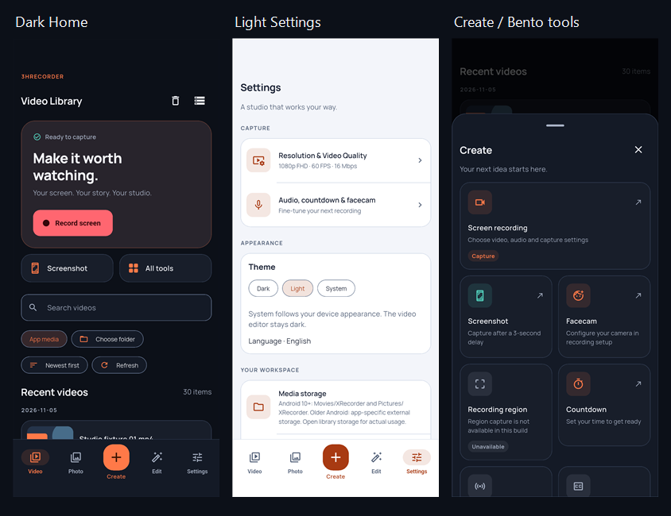

# TASK 01 — Emulator screenshots

Profile trên sdk_gphone16k_x86_64 / emulator-5554, 1080×2400, DPR 2.625. Media trong ảnh là fixture riêng của integration test; không phải bằng chứng native capture/export. Ảnh đã được rà trực quan.

| File | Trạng thái |
|---|---|
| [01 — Dark Home](screenshots/01_dark_home.png) | Record hero và shortcuts |
| [02 — Dark Library](screenshots/02_dark_library.png) | Hàng media, thumbnail, duration, action menu |
| [03 — Dark Create](screenshots/03_dark_create.png) | Công cụ quay / screenshot / facecam |
| [04 — Các công cụ chưa có](screenshots/04_unavailable_tools.png) | Region / Livestream / AI disabled |
| [05 — Light Settings](screenshots/05_light_settings.png) | Theme controls và settings groups |
| [06 — Light Home](screenshots/06_light_home.png) | Palette sáng và record button |
| [07 — Light Create](screenshots/07_light_create.png) | Bento cards ở light mode |
| [08 — Photo empty](screenshots/08_photo_empty.png) | Trạng thái thư viện rỗng |
| [09 — Editing hub](screenshots/09_editing_hub.png) | Công cụ/draft |
| [10 — Editor workspace](screenshots/10_editor_dark_workspace.png) | Editor tối trong app light |
| [11 — Chữ 200%](screenshots/11_large_text_settings.png) | Nội dung reflow, navigation labels theo mức 1.3× |

Chi tiết kiến trúc, nguồn tham khảo, tokens và checks: [DESIGN_SYSTEM.md](DESIGN_SYSTEM.md).
